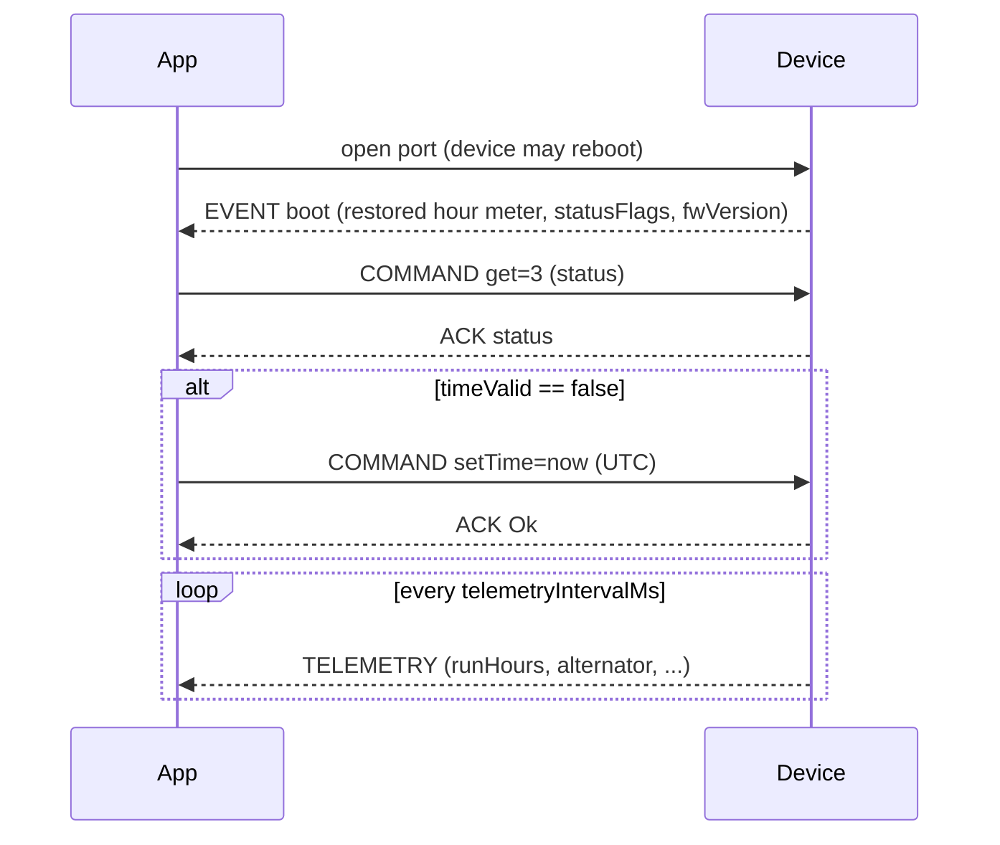
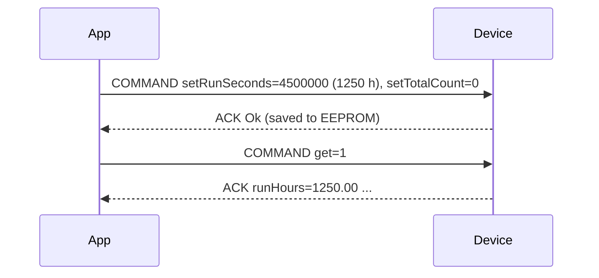
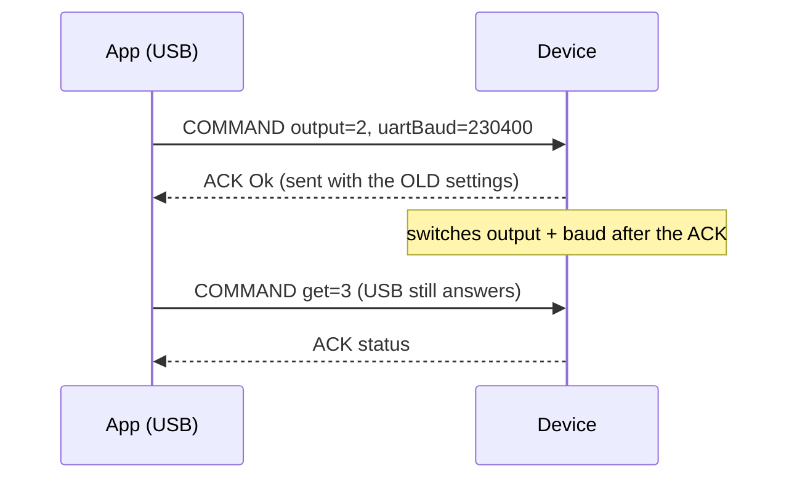
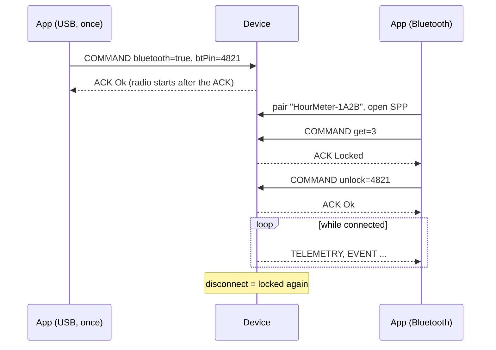

# Hour Meter Device: Integration Guide

**Audience:** developers building an app (desktop, mobile, server, PLC gateway) that reads data from or configures the totalizer / hour-meter device over a serial port.
**You need:** a serial port and the ability to read bytes. No SDK and no firmware knowledge are required.
**Protocol:** SensorFrame v1 binary frames, firmware 2.4.0. The byte-level appendix is [`sensorframe/SPEC.md`](../../sensorframe/SPEC.md).
**Byte-exact examples:** [FRAME-CATALOG.md](FRAME-CATALOG.md) lists every frame the device sends, with hex dumps. **No hardware?** The [simulator](../../simulator/README.md) runs a fake device on a virtual serial port.

| Section | Contents |
|---|---|
| [1. What the device does](#1-what-the-device-does) | What it measures and sends |
| [2. Connecting](#2-connecting) | Ports, wiring, serial settings, Bluetooth |
| [3. Quick start](#3-quick-start-first-data-in-5-minutes) | Decode your first frame (JS / Python reference code) |
| [4. Messages](#4-messages-the-device-sends) | Every message type and what it contains |
| [5. Tag dictionary](#5-tag-dictionary) | Every value: tag, type, unit, scale, calibration |
| [6. Commands](#6-commands) | Read, configure and control the device |
| [7. Settings](#7-settings-reference) | Configurable timing, ports and inputs |
| [8. Typical flows](#8-typical-flows) | Sequence diagrams |
| [9. Robustness rules](#9-robustness-rules-for-apps) | Errors, retries, time, RTC without battery, a device that sends nothing |
| [10. Versioning](#10-versioning) | Firmware version and compatibility promise |

---

## 1. What the device does

The device is installed on an engine or machine. It measures:

| Quantity | Source | Notes |
|---|---|---|
| **Engine run time** (hour meter) | Alternator signal | Counts only while the engine runs. Survives power loss (stored in EEPROM) |
| **Totalizer** | Pulse input (flow meter, counter) | Raw pulses plus scaled units (`pulsesPerUnit`) |
| **Real time** | DS3231 RTC | **UTC** Unix time. The device has no timezone |
| **Vibration** | MPU9250 accelerometer | RMS and peak in milli-g over a window. Use for engine-health trends |
| **Orientation** | Accelerometer + gyro (Kalman filter) | Roll and pitch in degrees |
| **Compass heading** | Magnetometer, tilt-compensated | 0–360°, magnetic north. Requires calibration |
| **Raw / filtered IMU** | Accelerometer, gyro, magnetometer | Optional stream at up to 100 Hz |

**Vehicle speed is not provided.** An IMU cannot measure speed reliably, because integrating acceleration drifts within seconds. Tag 45 is reserved for a future speed-sensor or GPS input.

The device **pushes** data periodically, and **answers commands** you send it.

---

## 2. Connecting

```
 Device (ESP32)                         Your computer / gateway
 ┌──────────────┐   USB cable          ┌───────────────────────┐
 │ USB port ────┼──────────────────────┤ /dev/ttyUSB0, COM3 …  │   always available
 │              │                      └───────────────────────┘
 │ GPIO17 (TX) ─┼──────► RX            ┌───────────────────────┐
 │ GPIO16 (RX) ◄┼─────── TX            │ 3.3 V TTL UART / USB- │   optional, e.g. to a
 │ GND ─────────┼─────── GND           │ TTL adapter / PLC     │   gateway or modem
 └──────────────┘                      └───────────────────────┘
```

| Setting | USB port | UART pins | Bluetooth (Classic SPP) |
|---|---|---|---|
| Baud rate | **115200, fixed** | 115200 by default; configurable with [`uartBaud`](#7-settings-reference) | n/a (open the port at any baud) |
| Format | 8 data bits, no parity, 1 stop bit (8N1), no flow control | same | byte stream, same frames |
| Levels | USB | **3.3 V TTL**. Never connect RS-232 (±12 V) directly | radio, about 10 m |
| Receives commands | always | always | after `unlock` with the PIN ([2.1](#21-bluetooth)) |
| Sends periodic data | if `output` is `usb` or `both` (default `usb`) | if `output` is `uart` or `both` | while an unlocked client is connected |

> **Opening the USB port may reboot the device.** Many ESP32 boards reset when DTR/RTS toggle. Wait for the boot EVENT (or about 2 s) before you send commands.

The USB port always accepts commands at 115200, so a wrong UART or Bluetooth setting can never lock you out.

### 2.1 Bluetooth

Bluetooth is **off by default**. Turn it on once over USB: `bluetooth = true` (tag 127), and set your own PIN with `btPin` (tag 128, 0–9999, default **1234**, so change it).

1. **Pair** with `HourMeter-XXXX` (the last 4 hex digits of the `deviceId`). Pairing needs no code: the ESP32 uses Simple Secure Pairing, so a pairing PIN cannot be enforced.
2. **Open the serial port** it creates:
   - **Linux:** `bluetoothctl` → `pair <MAC>`, `trust <MAC>`, then `sudo rfcomm bind 0 <MAC> 1`, which gives `/dev/rfcomm0`.
   - **Windows:** after pairing, use the "Standard Serial over Bluetooth link" (outgoing) COM port.
   - **Android:** RFCOMM, UUID `00001101-0000-1000-8000-00805F9B34FB`.
3. **Unlock the session:** send COMMAND `unlock` (tag 107, u16) = PIN. Until then the device sends **nothing** over Bluetooth and answers every command with `Locked` (9). A wrong PIN answers `BadPin` (10). After **5 wrong PINs**, unlocking is refused for **60 s**. Every new connection starts locked.
4. Use it like USB: commands, ACKs, TELEMETRY, IMU stream and EVENTs.

The Bluetooth radio cannot be reached from iPhones or web browsers (they only support BLE). Status tag 61 `btState` reports 0 off, 1 on (no client), 2 client locked, 3 client unlocked.

---

## 3. Quick start: first data in 5 minutes

The data is **binary**, so a serial terminal shows garbage. Each message is one **frame**:

```
 bytes on the wire:  [ COBS-encoded packet ............ ] 00 [ next packet ... ] 00
 packet:             [ header 12 B ][ records ... ][ CRC16 2 B ]
 header:             version(1) msgType(1) seq(u16) deviceId(u32) timestamp(u32)   little-endian
 record:             tag(1) fmt(1) value(1..8 bytes, by fmt)
```

To read data:

1. Read bytes until `0x00`. Those bytes, minus the `0x00`, are one frame.
2. **COBS-decode** the frame to get the packet.
3. Check the **CRC16** (last 2 bytes). If it fails, drop the frame.
4. Read the 12-byte header, then the records until the CRC.
5. Look up each record's **tag** in the [tag dictionary](#5-tag-dictionary) and multiply by its scale.

### 3.1 Reference decoder: JavaScript (no dependencies)

<!-- reference-decoder:js -->
```js
// sensorframe-decoder.js: minimal SensorFrame v1 decoder, no dependencies.
function cobsDecode(input) {                 // input: frame bytes WITHOUT the trailing 0x00
  const out = [];
  for (let i = 0; i < input.length;) {
    const code = input[i++];
    if (code === 0 || i + code - 1 > input.length) throw new Error('bad COBS');
    for (let j = 1; j < code; j++) out.push(input[i++]);
    if (code !== 0xff && i < input.length) out.push(0);
  }
  return Uint8Array.from(out);
}

function crc16(bytes) {                      // CRC16-CCITT-FALSE
  let crc = 0xffff;
  for (const b of bytes) {
    crc ^= b << 8;
    for (let k = 0; k < 8; k++) crc = crc & 0x8000 ? ((crc << 1) ^ 0x1021) & 0xffff : (crc << 1) & 0xffff;
  }
  return crc;
}

const FMT = { // code: [size, reader]
  1: [1, (v, o) => v.getUint8(o)],          2: [1, (v, o) => v.getInt8(o)],
  3: [2, (v, o) => v.getUint16(o, true)],   4: [2, (v, o) => v.getInt16(o, true)],
  5: [4, (v, o) => v.getUint32(o, true)],   6: [4, (v, o) => v.getInt32(o, true)],
  7: [4, (v, o) => v.getFloat32(o, true)],  8: [1, (v, o) => v.getUint8(o) !== 0],
  10: [8, (v, o) => v.getBigUint64(o, true)], 11: [8, (v, o) => v.getBigInt64(o, true)],
  12: [8, (v, o) => v.getFloat64(o, true)],
};

function decodeFrame(frame) {
  const p = cobsDecode(frame);
  if (p.length < 14) throw new Error('too short');
  const v = new DataView(p.buffer, p.byteOffset, p.byteLength);
  const body = p.length - 2;
  if (crc16(p.subarray(0, body)) !== v.getUint16(body, true)) throw new Error('CRC mismatch');
  if (p[0] !== 1) throw new Error('unsupported version');
  const msg = { msgType: p[1], seq: v.getUint16(2, true), deviceId: v.getUint32(4, true),
                timestamp: v.getUint32(8, true), records: {} };
  for (let o = 12; o < body;) {
    const tag = p[o], fmt = p[o + 1];
    o += 2;
    if (fmt === 9) { const n = p[o]; msg.records[tag] = p.slice(o + 1, o + 1 + n); o += 1 + n; continue; }
    if (!FMT[fmt] || o + FMT[fmt][0] > body) throw new Error('bad record');
    msg.records[tag] = FMT[fmt][1](v, o);
    o += FMT[fmt][0];
  }
  return msg; // records: { tag: rawValue }. Apply scales from the tag dictionary
}

module.exports = { decodeFrame, cobsDecode, crc16 };
```

Using it with a serial port (Node.js + the `serialport` package):

```js
const { SerialPort } = require('serialport');
const { decodeFrame } = require('./sensorframe-decoder');

let buf = [];
new SerialPort({ path: '/dev/ttyUSB0', baudRate: 115200 }).on('data', (chunk) => {
  for (const b of chunk) {
    if (b !== 0) { buf.push(b); continue; }
    if (buf.length) {
      try { console.log(decodeFrame(Uint8Array.from(buf))); } catch (e) { /* drop bad frame */ }
    }
    buf = [];
  }
});
```

On Node.js you can use the ready-made [`sensorframe`](../../sensorframe/js) npm package instead (`FrameStream`, `createCodec`). It applies names and scales from a tag table, and [`configurator/src/tags.ts`](../../configurator/src/tags.ts) is that table for this device (as an ES module; the Node codec takes the same `{ tag: { name, fmt, scale } }` shape).

### 3.2 Reference decoder: Python 3 (no dependencies)

<!-- reference-decoder:python -->
```python
# sensorframe_decoder.py: minimal SensorFrame v1 decoder, standard library only.
import struct

def cobs_decode(data: bytes) -> bytes:       # data WITHOUT the trailing 0x00
    out, i = bytearray(), 0
    while i < len(data):
        code = data[i]; i += 1
        if code == 0 or i + code - 1 > len(data):
            raise ValueError("bad COBS")
        out += data[i:i + code - 1]; i += code - 1
        if code != 0xFF and i < len(data):
            out.append(0)
    return bytes(out)

def crc16(data: bytes) -> int:               # CRC16-CCITT-FALSE
    crc = 0xFFFF
    for b in data:
        crc ^= b << 8
        for _ in range(8):
            crc = ((crc << 1) ^ 0x1021) & 0xFFFF if crc & 0x8000 else (crc << 1) & 0xFFFF
    return crc

FMT = {1: "<B", 2: "<b", 3: "<H", 4: "<h", 5: "<I", 6: "<i", 7: "<f", 8: "<?", 10: "<Q", 11: "<q", 12: "<d"}

def decode_frame(frame: bytes) -> dict:
    p = cobs_decode(frame)
    if len(p) < 14:
        raise ValueError("too short")
    body = len(p) - 2
    if crc16(p[:body]) != struct.unpack_from("<H", p, body)[0]:
        raise ValueError("CRC mismatch")
    if p[0] != 1:
        raise ValueError("unsupported version")
    msg_type, seq, device_id, timestamp = p[1], *struct.unpack_from("<HII", p, 2)
    records, o = {}, 12
    while o < body:
        tag, fmt = p[o], p[o + 1]; o += 2
        if fmt == 9:
            n = p[o]; records[tag] = p[o + 1:o + 1 + n]; o += 1 + n; continue
        if fmt not in FMT or o + struct.calcsize(FMT[fmt]) > body:
            raise ValueError("bad record")
        records[tag] = struct.unpack_from(FMT[fmt], p, o)[0]; o += struct.calcsize(FMT[fmt])
    return {"msgType": msg_type, "seq": seq, "deviceId": device_id, "timestamp": timestamp, "records": records}
```

With pySerial:

```python
import serial
from sensorframe_decoder import decode_frame

port = serial.Serial("/dev/ttyUSB0", 115200)
buf = bytearray()
while True:
    b = port.read(1)
    if b != b"\x00":
        buf += b
        continue
    if buf:
        try:
            print(decode_frame(bytes(buf)))
        except ValueError:
            pass  # drop corrupted frame
    buf.clear()
```

### 3.3 Check your decoder against this frame

This is a real TELEMETRY frame produced by the firmware (from its unit tests):

<!-- golden:telemetry -->
```
04 01 01 01 0e 78 56 34 12 70 3c c6 6a 01 05 20 aa 44 05 02 05 98 3a 01 09 03 08 01 04 05 48 e8 01 05 05 05 98 3a 01 06 32 08 01 35 05 01 01 01 03 24 ae 00
```

After COBS decoding:

```
01                version 1
01                msgType 1 = TELEMETRY
01 00             seq 1
78 56 34 12       deviceId 0x12345678
70 3c c6 6a       timestamp 1791376496 = 2026-10-07T12:34:56Z (UTC)
01 05 20 aa 44 00 tag 1  runSeconds  u32 4500000 s
02 05 98 3a 00 00 tag 2  totalCount  u32 15000 pulses
03 08 01          tag 3  alternator  bool true (engine running)
04 05 48 e8 01 00 tag 4  runHours    u32 125000 × 0.01 = 1250.00 h
05 05 98 3a 00 00 tag 5  totalUnits  u32 15000 × 0.01 = 150.00 units
32 08 01          tag 50 timeValid   bool true
35 05 00 00 00 00 tag 53 statusFlags u32 0 (all OK)
24 ae             CRC16 0xAE24
```

---

## 4. Messages the device sends

Every frame header carries `msgType`, `seq` (the device's own counter, incremented per frame and wrapping 65535 → 0), `deviceId` (unique per chip), and `timestamp`.

> **`timestamp` rule:** if the device clock is valid, the timestamp is **UTC Unix seconds**; otherwise it is **seconds since boot**. To tell them apart, any value below `946684800` (2000-01-01) is uptime. Never treat it as local time.

| msgType | Name | When | Records |
|---:|---|---|---|
| 1 | **TELEMETRY** | Every `telemetryIntervalMs` (default 1 s) | Always 1, 2, 3, 4, 5, 50, 53. With an IMU: 40, 41, plus 42 when a heading is available, plus 43 and 44 after the first vibration window |
| 2 | **EVENT** | Boot; calibration finished | Tag 8 (`eventKind`) says which. See below |
| 4 | **ACK** | Reply to every COMMAND | 242 `ackSeq`, 243 `ackStatus`, 59 `rejectedTag` on error, plus the requested data |
| 128 | **IMU stream** | Every 1/`imuStreamHz` s when `streamMode` ≠ off | Raw: 20–25 (+26–28 with magnetometer). Filtered: 30–35 (+36–38), plus 40, 41, 42 |

**EVENT kinds:**

| `eventKind` (tag 8) | Meaning | Records |
|---:|---|---|
| 1 | **Boot**: the device restarted | 1–7 (restored hour meter), 50, 51, 52, 53, 55, 56, 57, 58, 60, 61, 62, 63, 241, plus 54 if the RTC is present |
| 2 | **Calibration finished** | 105 (which calibration), 9 (`calibResult`, an [ackStatus](#63-ackstatus-codes) code), plus 130–148 when successful |
| 3 | **Modules changed**: a module was plugged in or lost while running | 55 `devices` (new set), 50, 51, 52, 53, 56, 57, 58, 60, 61, 62, 63, 241, plus 54 if the RTC is present |

A boot EVENT with `resetReason` ≠ 1 (see tag 58) means the device restarted without a power cut. Log it together with `lastCause` (tag 62) and `lastStage` (tag 63): they say why and during what. A watchdog restart while `IMU`, for example, points at the IMU wiring.

---

## 5. Tag dictionary

`value = raw × scale`. Types: `u8/u16/u32` unsigned, `i16` signed, `f32` IEEE float, `bool` (0/1), all little-endian.

### 5.1 Hour meter

| Tag | Name | Type | Scale | Unit | Meaning |
|---:|---|---|---:|---|---|
| 1 | `runSeconds` | u32 | 1 | s | Total engine run time. **This is the hour meter** |
| 2 | `totalCount` | u32 | 1 | pulses | Totalizer, raw pulses |
| 3 | `alternator` | bool | | | Engine running now (debounced) |
| 4 | `runHours` | u32 | 0.01 | h | `runSeconds / 3600`, two decimals, for display |
| 5 | `totalUnits` | u32 | 0.01 | unit | `totalCount / pulsesPerUnit`, two decimals |
| 6 | `lastSavedEpoch` | u32 | 1 | s UTC | When the counters were last written to EEPROM (0 if time was unknown) |
| 7 | `journalSeq` | u32 | 1 | | Save counter (increases by 1 per EEPROM save) |
| 8 | `eventKind` | u8 | | | EVENT type: 1 boot, 2 calibration finished, 3 modules changed |
| 9 | `calibResult` | u8 | | | Result of a calibration (ackStatus code) |

### 5.2 IMU (stream, msgType 128)

| Tag | Name | Type | Scale | Unit |
|---:|---|---|---:|---|
| 20 / 21 / 22 | `rawAccelX` / `rawAccelY` / `rawAccelZ` | i16 | 0.001 | g |
| 23 / 24 / 25 | `rawGyroX` / `rawGyroY` / `rawGyroZ` | i16 | 0.1 | °/s |
| 26 / 27 / 28 | `rawMagX` / `rawMagY` / `rawMagZ` | i16 | 0.1 | µT |
| 30 / 31 / 32 | `accelX` / `accelY` / `accelZ` (filtered) | i16 | 0.001 | g |
| 33 / 34 / 35 | `gyroX` / `gyroY` / `gyroZ` (filtered) | i16 | 0.1 | °/s |
| 36 / 37 / 38 | `magX` / `magY` / `magZ` (filtered) | i16 | 0.1 | µT |

The **raw** values come straight from the sensor. The **filtered** values have calibration offsets removed and a Kalman filter applied (less noise, slightly delayed). Axes: x and y in the board plane, z up when the board lies flat.

### 5.3 Derived values

| Tag | Name | Type | Scale | Unit | Meaning |
|---:|---|---|---:|---|---|
| 40 | `roll` | i16 | 0.01 | ° | Rotation about x, −180…180 |
| 41 | `pitch` | i16 | 0.01 | ° | Nose up positive, −90…90. Firmware 2.3.0 and older sent the opposite sign (nose down positive); negate it if `fwVersion` < 2.4.0 |
| 42 | `heading` | u16 | 0.01 | ° | 0 = magnetic north, clockwise. Only sent when available |
| 43 | `vibRms` | u16 | 1 | mg | Vibration RMS over `vibrationWindowMs` (gravity removed) |
| 44 | `vibPeak` | u16 | 1 | mg | Vibration peak in the same window |
| 45 | `speed` | | | | **Reserved**: not sent by this firmware |

### 5.4 Status

| Tag | Name | Type | Scale | Unit | Meaning |
|---:|---|---|---:|---|---|
| 50 | `timeValid` | bool | | | RTC time is trustworthy. If false, set it with [`setTime`](#62-command-reference) |
| 51 | `epoch` | u32 | 1 | s UTC | Device time |
| 52 | `uptime` | u32 | 1 | s | Since boot |
| 53 | `statusFlags` | u32 | | | Bit set, [see 5.5](#55-status-flags-tag-53) |
| 54 | `rtcTemp` | i16 | 0.25 | °C | RTC chip temperature (≈ board temperature) |
| 55 | `devices` | u8 | | | Chips found: bit 0 EEPROM, bit 1 RTC, bit 2 IMU, bit 3 magnetometer |
| 56 | `i2cErrors` | u32 | | | Sensor bus errors since boot |
| 57 | `overruns` | u32 | | | Times the device could not keep up with its schedule (lower rates or raise the baud) |
| 58 | `resetReason` | u8 | | | 1 power-on, 3 software (reboot command), 4 crash, 5/6/7 watchdog, 9 brown-out (supply dip) |
| 59 | `rejectedTag` | u8 | | | In an error ACK: which tag was refused |
| 60 | `settingsSource` | u8 | | | 0 factory defaults, 1/2 stored copy A/B |
| 61 | `btState` | u8 | | | Bluetooth: 0 off, 1 on (no client), 2 client connected and locked, 3 client connected and unlocked |
| 62 | `lastCause` | u8 | | | Why the device restarted last time: 0 none (power-on, brown-out), 1 watchdog (the firmware stalled for 5 s), 2 I2C bus stuck for 30 s, 3 USB transmit stalled for 10 s, 4 [panic signal](#64-panic-signal-restart-without-a-frame), 5 `reboot` command, 6 crash |
| 63 | `lastStage` | u8 | | | What it was doing at that moment: 0 unknown (power-on), 1 boot, 2 opening USB, 3 starting I2C, 4 EEPROM, 5 opening UART / Bluetooth, 6 RTC, 7 IMU, 8 serial / command, 9 inputs, 10 telemetry, 11 module presence check |
| 241 | `fwVersion` | u32 | | | `0x00MMmmpp`, e.g. `0x00020400` = 2.4.0 |
| 242 | `ackSeq` | u16 | | | In ACK: the `seq` of your command |
| 243 | `ackStatus` | u8 | | | In ACK: result, [see 6.3](#63-ackstatus-codes) |

### 5.5 Status flags (tag 53)

| Bit | Name | Meaning / action |
|---:|---|---|
| 0 | `eepromMissing` | No EEPROM: counters are **not** saved. Service the device |
| 1 | `rtcMissing` | No RTC: timestamps are uptime |
| 2 | `timeInvalid` | The device does not know the time (new device, RTC without battery after a power cut, or no RTC). Send `setTime` |
| 3 | `imuMissing` | No IMU: no vibration or orientation data |
| 4 | `magMissing` | No magnetometer (some boards are MPU6500): no heading |
| 5 | `imuNotCalibrated` | Run `calibrate` 1 |
| 6 | `magNotCalibrated` | Run `calibrate` 2; heading is inaccurate until then |
| 7 | `settingsDefaults` | Factory settings in use (first boot, or stored settings unreadable) |
| 8 | `journalEmpty` | No saved hour meter found at boot (counting started at 0) |
| 9 | `storageError` | The last EEPROM write failed. The device retries; persistent = hardware fault |
| 10 | `imuStuck` | IMU returns identical samples (frozen) |
| 11 | `imuSaturated` | Acceleration or rotation exceeded the ±4 g / ±500 °/s range |
| 12 | `i2cErrors` | Sensor bus errors occurred (see tag 56) |
| 13 | `eepromFormatted` | EEPROM was blank or foreign and was initialised at this boot |
| 14 | `calibrating` | A calibration is running |
| 15 | `rtcBatteryLost` | The time had been set, but the RTC lost it during the last power-off: its backup battery is missing or flat. Ask the user to fit one (see [9.2](#92-running-without-an-rtc-battery)). Reported from boot until the next reboot |
| 17 | `settingsNotSaved` | Settings were changed while no EEPROM was attached. They are active now and are saved automatically when an EEPROM is plugged in; lost if the device reboots first |
| 16 | `timeNotBackedUp` | The time is valid but held only in the ESP32's RAM (no RTC, or the RTC could not store it). It will be lost at the next reboot; send `setTime` again after each boot EVENT |
| 18 | `safeMode` | The device restarted itself 3 times in a row without being asked (watchdog, crash, I2C stuck, USB stalled), so it booted **without I2C**: no EEPROM, RTC or IMU, counting in RAM only. Read `lastCause` / `lastStage`, fix the wiring, then power-cycle, send `reboot` or the panic signal ([9.3](#93-the-device-sends-nothing)) |

### 5.6 Calibration values (read-only)

Returned by `get` 4 and in the calibration-finished EVENT. All `f32`. Useful for diagnostics and for copying a calibration to service records.

| Tag | Name | Unit | Meaning |
|---:|---|---|---|
| 130 / 131 / 132 | `calAccelBiasX` / `Y` / `Z` | g | Accelerometer offset removed from readings |
| 133 / 134 / 135 | `calGyroBiasX` / `Y` / `Z` | °/s | Gyro offset removed from readings |
| 136 / 137 / 138 | `calAccelNoiseX` / `Y` / `Z` | g² | Measured accelerometer noise (filter input) |
| 139 / 140 / 141 | `calGyroNoiseX` / `Y` / `Z` | (°/s)² | Measured gyro noise (filter input) |
| 142 / 143 / 144 | `calMagOffsetX` / `Y` / `Z` | µT | Hard-iron offset |
| 145 / 146 / 147 | `calMagScaleX` / `Y` / `Z` | | Soft-iron scale |
| 148 | `calFlags` | u8 | bit 0 accel/gyro calibrated, bit 1 magnetometer calibrated |

---

## 6. Commands

### 6.1 How commands work

Send a frame with `msgType = 3` (COMMAND). Put **your own** `seq` in the header, a new value for every new command; `deviceId` and `timestamp` may be 0. Add one or more records. The device answers with **exactly one ACK** (msgType 4) on the same port, containing `ackSeq` = your seq and `ackStatus`.

- **All or nothing.** If any record in the command is invalid, *nothing* is applied, and the ACK says which tag (`rejectedTag`).
- **Several settings in one command** are allowed and saved together.
- **Retries are safe.** If you get no ACK within 1.5 s, resend the **same bytes** (same seq). The device recognises the repeat within 10 s and replays the original ACK *without executing again*.

Example, set the clock (`setTime` = 1791376496, seq 42), exactly as sent on the wire:

<!-- golden:set-time -->
```
04 01 03 2a 01 01 01 01 01 01 01 01 09 64 05 70 3c c6 6a 05 6a 00
```

```
packet: 01 03 2a 00 | 00 00 00 00 | 00 00 00 00 | 64 05 70 3c c6 6a | 05 6a
        v1 COMMAND seq 42   deviceId 0     timestamp 0   tag 100 u32 1791376496   CRC
```

### 6.2 Command reference

| Tag | Command | Value | What it does | ACK contains |
|---:|---|---|---|---|
| 100 | `setTime` | u32 UTC epoch (2000–2099) | Sets the device clock and the RTC. Use `Math.floor(Date.now()/1000)` / `int(time.time())`. **Always UTC**. Accepted even without a working RTC; then `timeNotBackedUp` is set | status |
| 101 | `get` | u8: 1 hour meter, 2 settings, 3 status, 4 calibration | Reads data | the requested tags (1–7 / 110–128 / 50–58, 60–63, 241 / 130–148) |
| 102 | `setRunSeconds` | u32 seconds | Sets the hour meter to **any value** (e.g. installing on a machine with 1250.5 h → `round(1250.5 × 3600)` = 4501800). `0` resets the hour meter only. Saved immediately | status |
| 103 | `setTotalCount` | u32 pulses | Sets the totalizer to **any value**. To set it in units (litres…), send `round(units × pulsesPerUnit)`; read `pulsesPerUnit` with `get` 2. `0` resets the totalizer only. Saved immediately | status |
| 104 | `resetCounters` | u32, **must be `0x5245534E`** | Sets **both** hour meter and totalizer to 0. The magic value prevents accidents. To reset only one, use 102 or 103 with `0` | status |
| 105 | `calibrate` | u8: 1 accel+gyro, 2 magnetometer | Starts a calibration ([procedure](#calibration-procedure)). The result arrives later as EVENT kind 2 | status (= started) |
| 106 | `reboot` | u8 any | Saves counters, sends the ACK, restarts. A boot EVENT follows (`lastCause` 5). Also leaves safe mode | status |
| 107 | `unlock` | u16 PIN | Unlocks a Bluetooth session ([2.1](#21-bluetooth)). Accepted and ignored on USB/UART | status (`BadPin` / `Locked` on failure) |
| 110–128 | settings | see [§7](#7-settings-reference) | Changes and saves settings | status |

Send one `get` per command. A single ACK has room for one data set.

Example ACK for `get` 1 (hour meter), answering a command with seq 43:

<!-- golden:ack-get-hour -->
```
04 01 04 02 0c 78 56 34 12 70 3c c6 6a f2 03 2b 03 f3 01 06 01 05 20 aa 44 05 02 05 98 3a 01 09 03 08 01 04 05 48 e8 01 05 05 05 98 3a 01 0b 06 05 38 3c c6 6a 07 05 2c 03 01 03 61 1b 00
```

It decodes to `ackSeq 43, ackStatus 0, runSeconds 4500000, totalCount 15000, alternator true, runHours 1250.00, totalUnits 150.00, lastSavedEpoch 1791376440, journalSeq 812`.

#### Calibration procedure

| Kind | Operator action | Duration | Fails when |
|---|---|---|---|
| 1 accel + gyro | Place the device **flat, component side up, completely still** | about 5 s (512 samples) | The board is tilted more than about 6° or moving |
| 2 magnetometer | Slowly **rotate the device in all directions** (figure-eight, every axis) away from steel | 20 s | An axis did not swing at least 20 µT |

Results are saved in the device and survive reboot. Read them with `get` 4.

### 6.3 ackStatus codes

| Code | Name | Meaning | What to do |
|---:|---|---|---|
| 0 | Ok | Done | |
| 1 | UnknownTag | A record tag is not a command or setting | Check `rejectedTag`; your app may be newer than the firmware |
| 2 | InvalidValue | Value out of range or of the wrong type | Check `rejectedTag` and [§7](#7-settings-reference) |
| 3 | StorageError | EEPROM write failed | Retry once; if it repeats, the device needs service |
| 4 | DeviceMissing | Needed chip absent (e.g. `calibrate` without IMU) | Check `devices` (tag 55) |
| 5 | Busy | A calibration is already running | Wait for the calibration EVENT |
| 6 | BadMagic | `resetCounters` without the magic value | |
| 7 | Unsupported | Feature not on this hardware (magnetometer) | |
| 8 | Failed | Operation failed (calibration: moved or not rotated enough) | Repeat the procedure |
| 9 | Locked | Bluetooth session not unlocked, or locked out after 5 wrong PINs | Send `unlock` with the PIN (wait 60 s after a lockout) |
| 10 | BadPin | `unlock` with a wrong PIN | Check `btPin` (readable over USB with `get` 2) |

---

### 6.4 Panic signal (restart without a frame)

When the device no longer answers commands, send **64 bytes of `0x00`** on the USB port or the UART pins. The device restarts within about 100 ms, with no ACK. The boot EVENT that follows has `lastCause` 4.

```js
port.write(new Uint8Array(64)); // 64 zero bytes
```

- **Why it can't fire by accident:** a frame contains `0x00` only once, as its delimiter, so normal traffic never has two zeros in a row.
- **Wired ports only.** Over Bluetooth it is ignored, so nobody can restart the device without the PIN.
- **When it does not help:** if the firmware is completely frozen, the watchdog restarts it within 5 s anyway. If the port stays silent after that, use a hard reset: pulse the EN pin (on DevKit boards, RTS of the USB adapter), as `hour-meter reset --hard` does. See [9.3](#93-the-device-sends-nothing).

## 7. Settings reference

Read all settings with `get` 2. To change one or more, send their tags in a COMMAND. Values are validated, saved to EEPROM (power-safe), and **applied immediately** unless the table says otherwise.

| Tag | Name | Type | Default | Range | Controls |
|---:|---|---|---:|---|---|
| 110 | `telemetryIntervalMs` | u16 | 1000 | 100–60000 | TELEMETRY period |
| 111 | `imuSampleHz` | u16 | 100 | 10–500 | IMU read + filter rate |
| 112 | `imuStreamHz` | u8 | 10 | 0–100, ≤ `imuSampleHz` | IMU stream rate (0 = off) |
| 113 | `streamMode` | u8 | 2 | 0 off, 1 raw, 2 filtered, 3 both | IMU stream content |
| 114 | `persistIntervalS` | u16 | 60 | 10–3600 | Max time between EEPROM saves while running (always saved when the engine stops) |
| 115 | `vibrationWindowMs` | u16 | 1000 | 100–10000 | Window for `vibRms` / `vibPeak` |
| 116 | `rtcSyncIntervalS` | u16 | 60 | 1–3600 | How often the RTC is re-read |
| 117 | `output` | u8 | 1 | 1 usb, 2 uart, 3 both | Where periodic data goes. **Applied after the ACK** |
| 118 | `uartBaud` | u32 | 115200 | 9600, 19200, 38400, 57600, 115200, 230400, 460800, 921600 | UART-pin baud (USB stays 115200). **Applied after the ACK** |
| 119 | `altActiveHigh` | bool | false | | Alternator input level that means running. `false` matches the standard PC817 optocoupler input (running = LOW) |
| 120 | `altDebounceMs` | u16 | 200 | 0–5000 | Input must be stable this long to count |
| 121 | `pulseRisingEdge` | bool | false | | Count rising (true) or falling (false) edges |
| 122 | `pulseMinIntervalUs` | u16 | 1000 | 0–65535 | Ignore pulses closer than this (debounce) |
| 123 | `pulsesPerUnit` | u16 | 1 | 1–65535 | Scale for `totalUnits` (e.g. pulses per litre) |
| 124 | `kalmanQAccel` | f32 | 0.0005 | 1e-7–1.0 | Filter responsiveness, accelerometer (higher = faster, noisier) |
| 125 | `kalmanQGyro` | f32 | 0.01 | 1e-7–10.0 | Same, gyro |
| 126 | `kalmanQMag` | f32 | 0.05 | 1e-7–10.0 | Same, magnetometer |
| 127 | `bluetooth` | bool | false | | Bluetooth SPP radio on/off. **Applied after the ACK** |
| 128 | `btPin` | u16 | 1234 | 0–9999 | PIN for `unlock` on Bluetooth. **Change it at installation** |

**Bandwidth.** Make sure the data fits the port (about 1 byte per 10 baud):

| Stream | Bytes per frame | 10 Hz | 50 Hz | 100 Hz |
|---|---:|---|---|---|
| filtered (with magnetometer) | ≈ 64 | 115200 OK | 115200 OK | 115200 OK (56 %) |
| raw (with magnetometer) | ≈ 52 | 115200 OK | 115200 OK | 115200 OK (45 %) |
| both | ≈ 100 | 115200 OK | 115200 OK (43 %) | **≥ 230400** |

When frames don't fit, the device drops them rather than slowing down. Watch the `overruns` count (tag 57).

---

## 8. Typical flows

### 8.1 Connect and start reading



### 8.2 Set the counters (machine already has hours, meter swap, totalizer reset)



### 8.3 Move telemetry to the UART pins safely



### 8.4 Manage over Bluetooth



### 8.5 Calibrate

```mermaid
sequenceDiagram
    participant App
    participant Device
    App->>Device: COMMAND calibrate=1
    Device-->>App: ACK Ok (started; statusFlags.calibrating)
    Note over Device: ~5 s, board flat and still
    Device-->>App: EVENT kind=2, calibResult=0, calibration values
```

---

## 9. Robustness rules for apps

1. **Drop bad frames silently.** A CRC or COBS error means noise or a partial frame (common right after connecting). The next `0x00` resynchronises the stream.
2. **Ignore unknown tags and unknown msgTypes.** Newer firmware may add data. Your app must keep working.
3. **Use a new `seq` per command**, and **resend the same bytes** on timeout (1.5 s, up to 3 tries). Retries never execute twice.
4. **Time is UTC.** Store and compare timestamps as UTC epoch seconds, and convert to local time only for display. The device never applies a timezone, so moving the machine or daylight saving can't corrupt data.
5. **Check `timeValid`** before trusting timestamps. When it is false, the header timestamp is uptime (always below 946684800).
6. **Device `seq` wraps** 65535 → 0. A jump or reset of `seq` together with a boot EVENT means the device restarted.
7. **Hour meter after power loss.** The device saves at least every `persistIntervalS` while running and on every engine stop. After a sudden power cut, at most the last interval (default ≤ 60 s) is lost; the counter never jumps or corrupts.
8. **Watch `statusFlags`.** Show `timeInvalid`, `rtcBatteryLost`, `eepromMissing` and `storageError` to the user; they need action.

### 9.1 Modules are optional

Every I2C module (EEPROM, RTC, IMU) is optional and may be plugged in or removed while the device runs. Read `devices` (tag 55) and `statusFlags` to know what is available, and listen for EVENT kind 3 to react to changes. What each missing module means:

| Missing | Still works | Not available |
|---|---|---|
| EEPROM | Counting (RAM), all settings (RAM, flag `settingsNotSaved`) | Persistence across reboots; `setRunSeconds` / `setTotalCount` / `resetCounters` answer `DeviceMissing` |
| RTC | Everything; `setTime` keeps time in RAM (`timeNotBackedUp`) | Time after a reboot until the app sends it again |
| IMU | Everything else | Vibration, roll/pitch, heading, IMU stream, calibration |

When an EEPROM is attached after boot, the hour meter it stored is **added** to what was counted meanwhile (engine time without storage is still real engine time).

### 9.2 Running without an RTC battery

Many DS3231 boards are shipped or installed without a coin cell, and vehicle power is often cut with the ignition. The device handles this without losing data:

| Situation | What the device does | What your app should do |
|---|---|---|
| Power returns, RTC has no battery | Hour meter and totalizer continue from EEPROM (unaffected). `timeValid=false`, header timestamps are uptime, counter saves are stamped `lastSavedEpoch = 0` | Send `setTime` **automatically** when you see `timeValid=false` (rate-limit to about once per 30 s). The reference client does this: `DeviceClient.enableAutoTimeSync()` in [`configurator/src/device.ts`](../../configurator/src/device.ts) |
| First boot after the time was lost | Also sets `rtcBatteryLost` (bit 15) | Tell the user the RTC needs a battery |
| `setTime` received | Writes the RTC and uses the time immediately. If the RTC is missing or cannot be written, keeps the time in RAM and sets `timeNotBackedUp` (bit 16) | Nothing more; re-send after each boot EVENT while `timeNotBackedUp` is set |
| RTC loses its time while running (supply dip) | Rewrites the RTC from its RAM clock at the next RTC sync (≤ `rtcSyncIntervalS`) | Nothing |
| No app connected after a power cut | Keeps counting with uptime timestamps until an app sets the time | When you connect later, the auto-sync fixes the clock. Times before that are only known as uptime since boot (`uptime`, tag 52) |

### 9.3 The device sends nothing

Check these in order:

1. **Wait 2 s after opening the port.** Opening it may reboot the board ([§2](#2-connecting)).
2. **Telemetry may go elsewhere.** If the `output` setting is 2 (UART pins only), USB only answers commands. Send `get` 2 over USB and look at `output` (tag 117).
3. **Send the panic signal** ([6.4](#64-panic-signal-restart-without-a-frame)), then wait 3 s for a boot EVENT.
4. **Hard reset:** pulse EN (RTS on DevKit boards), or power-cycle.
5. **Read the boot EVENT.** `lastCause` and `lastStage` say what went wrong last time. `safeMode` (flag 18) means it kept failing, usually on the I2C wiring.

The device also recovers by itself:

| Trouble | What the device does |
|---|---|
| The firmware stalls (any step, including boot) | The watchdog restarts it after 5 s (`lastCause` 1) |
| The I2C bus keeps timing out for 30 s, even after bus recovery | Restarts (`lastCause` 2). A missing module is not trouble |
| The USB transmit buffer does not drain for 10 s | Restarts (`lastCause` 3) |
| 3 such restarts in a row | Boots in safe mode: USB, UART and counting work; I2C modules are skipped until a power-cycle, `reboot` or the panic signal |

The restart counter clears after 10 minutes of normal running. USB is opened before any I2C access, so a stuck sensor bus can't keep USB silent.

---

## 10. Versioning

- `fwVersion` (tag 241, in the boot EVENT and `get` 3) is `0x00MMmmpp`.
- **Compatibility promise:** within major version 2, tags are only **added**. Existing tag numbers, types, scales and meanings never change, and command semantics stay the same. A breaking change means major version 3 and SensorFrame `version` 2.
- The wire format (framing, CRC, record encoding) is specified in [`sensorframe/SPEC.md`](../../sensorframe/SPEC.md). That file is the appendix to this guide; send them together.

| Firmware | Changes |
|---|---|
| 2.0.0 | First release with EEPROM storage, RTC, IMU (vibration, orientation, heading), commands and settings |
| 2.1.0 | RTC without battery: `rtcBatteryLost` and `timeNotBackedUp` flags; `setTime` works without an RTC (RAM time); RTC self-repair from the RAM clock |
| 2.2.0 | Modular: EEPROM, RTC and IMU are hot-pluggable (detected within ~2 s, lost after ~6 s, EVENT kind 3); settings work without EEPROM (`settingsNotSaved`); EEPROM attached later merges its stored hour meter |
| 2.3.0 | Bluetooth Classic SPP (off by default, `bluetooth` / `btPin` settings, PIN-locked sessions with `unlock`, `Locked` / `BadPin` ACK codes, `btState`) |
| 2.4.0 | Self-recovery: watchdog armed from the first instruction of boot, USB opened before I2C, restarts on a stuck I2C bus or stalled USB, the [panic signal](#64-panic-signal-restart-without-a-frame), safe mode (flag 18), `lastCause` / `lastStage` (tags 62, 63). **Fix:** `pitch` (tag 41) now follows this guide (nose up positive); 2.3.0 and older sent it with the opposite sign |
