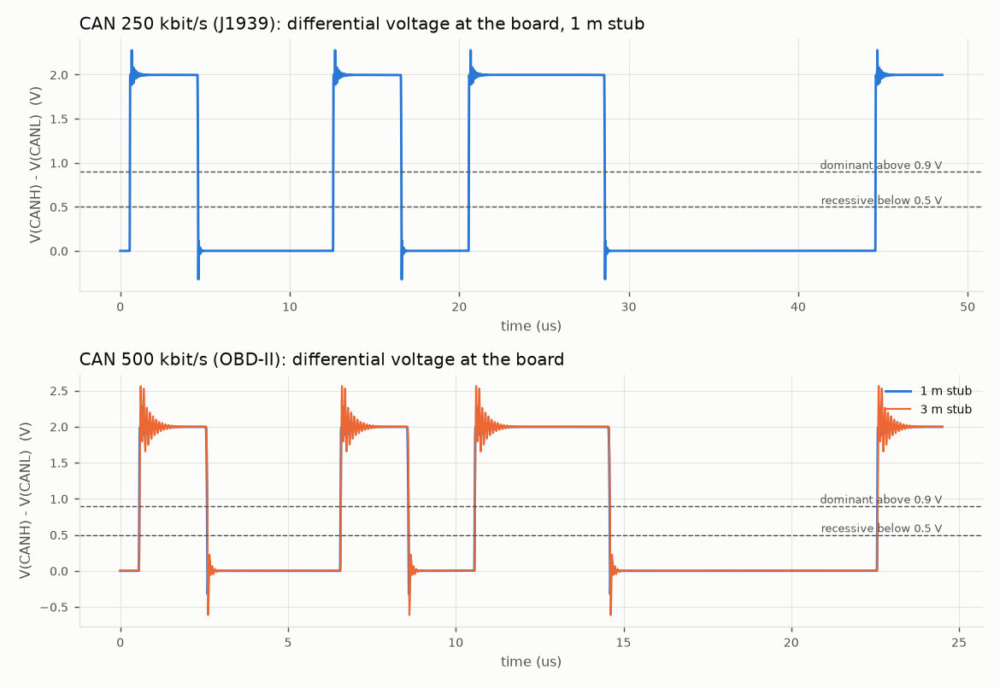
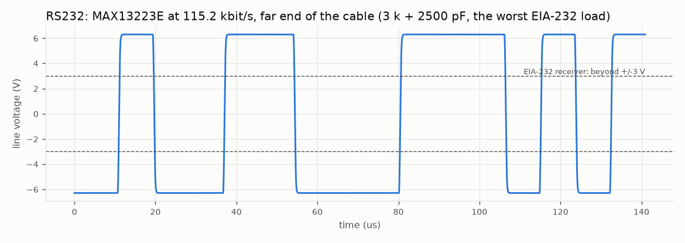

# Micro-Fit + CAN + RS232 board: simulations

What the SPICE simulations of the [Micro-Fit + CAN + RS232 board](README.md) show, how each one is set up, and how to run them again.

- **Scope:** the parts this board adds or changes, namely the CAN port, the RS232 port, the new RS485 protector, the 2 × 8 harness connector J1 and the power budget. The circuits it shares with the [Micro-Fit board](../hour-meter-board-microfit/README.md) keep their results in the [fault analysis](../fault-analysis/README.md) ([What still applies](#what-still-applies-from-the-micro-fit-board)).
- **Tool:** ngspice-47, batch mode. The decks are written by [`microfit_can.py`](../fault-analysis/microfit_can.py), which reuses the ngspice runner and the diode models of [`faults.py`](../fault-analysis/faults.py).
- **Values:** every part value comes from this board's schematic sheets. Every model parameter comes from the datasheet named next to it ([Models](#models)).
- **Verdicts:**
  - **PASS:** every part stays inside its absolute maximum ratings;
  - **PASS\*:** the board survives because a fuse, a current limit or a thermal shutdown acts, or only a part outside the board is stressed;
  - **FAIL:** a part on the board is damaged.

## Results at a glance

| Area | Result | Key figures |
|---|---|---|
| [CAN bus timing](#1-can-bus-timing) | **6 of 6 PASS** | 2.0 V dominant at every sample point (the receiver needs 0.9 V); settles within 0.3 µs of a 2 µs bit at 500 kbit/s, even on a 3 m stub |
| [CAN / RS485 wired to a supply](#2-can-and-rs485-lines-wired-to-a-supply) | **PASS up to 36 V**, FAIL at 40 V | 12 V, 24 V (28.8 V), a 24 V jump start (36 V) and a reversed 24 V supply are survived; at 40 V the 32 V protector conducts and burns |
| [RS232](#3-rs232) | **PASS** | ±6.3 V at the far end into the worst EIA-232 load (3 kΩ + 2500 pF); TX and RX survive ±70 V |
| [J1: neighbouring pins shorted](#4-j1-neighbouring-pins-shorted) | **22 of 22 pairs survived**: 17 PASS, 5 PASS\* | no short between two J1 pins damages the board; the PASS\* cases end in a vehicle fuse or the BSP75N's current limit |
| [Power](#5-power-budget) | INFO | +85 mW idle for CAN + RS232: 0.52 W, 44 mA at 12 V |

## Running them

```bash
cd schematic/fault-analysis
python3 microfit_can.py       # about 3 minutes: the six CAN timing runs go side by side
```

- **Output:** a results table on the console, and two plots in `plots/`: `can-bus.png` and `rs232-line.png`.
- **Working files:** each deck lands in `work/<name>.cir` with its waveform in `work/<name>.dat` (git-ignored). A deck can be run alone with `ngspice -b work/<name>.cir`.

## Method

- **Models:** behavioural models for the transceivers (drivers, receivers, input resistance) and fitted diode models for the protectors.
  - The vendors publish no SPICE model for the TJA1051 or the NUP3105L (NXP releases its IBIS models only under NDA).
  - So each model is fitted to the datasheet figures that set the margin under test: output levels, thresholds, input resistance, breakdown and clamping voltage, and capacitance.
- **What the models are good for:** levels, timing margins and the voltage and current on each part. Not for exact edge shapes or emissions.
- **Faults:** DC operating points or sweeps. A miswired harness pin sees a steady voltage, so a DC solution gives the stress that lasts. Fast transients ride on top of it and are the protectors' job ([Limits](#limits)).

### Models

| Part | Model | Fitted to (datasheet) |
|---|---|---|
| TJA1051T/3 driver | each line: 4.0 V (CANH) / 1.0 V (CANL) behind 15 Ω while dominant, off while recessive; 40 ns edges | VO(dif) 1.5–3 V into 45–65 Ω, typical 2 V |
| TJA1051T/3 receiver and bias | dominant above 0.9 V, recessive below 0.5 V; 25 kΩ per line to VCC/2; 20 pF per line | Vth(RX)dif 0.5–0.9 V; Ri 9–28 kΩ; Ci(cm) ≤ 20 pF |
| SZNUP3105L (D701, D1001) | per line, two zeners back to back to GND: BV 37 V (35.6 V for faults), Rs 3.5 Ω, 30 pF | VBR ≥ 35.6 V at 1 mA; VC 59 V at 5 A, 66 V at 8 A; C ≤ 30 pF |
| THVD2410 bus pins | 96 kΩ to GND | as in `faults.py`; bus pins rated ±70 V |
| MAX13223E driver | ±6.4 V behind 50 Ω, ±80 mA limit, 0.5 µs edges; 6 mA above its 14 V overvoltage threshold | VO ±5 V min / ±6 V typ into 3 kΩ; ISC ±80 mA; overvoltage current ≤ 6 mA |
| MAX13223E receiver | 3–7 kΩ input (above 32 V: 35–250 kΩ); thresholds 0.6 / 2.4 V | RIN, VTH at VCC = 3.3 V |
| CAN cable | backbone: two 60 Ω lossless lines (the odd mode of a 120 Ω pair), 5 ns/m; stub: an LC ladder, one section per metre (300 nH and 83 pF per metre per line) | twisted pair, Z0 = 120 Ω differential |
| RS232 cable | 2500 pF to GND | the EIA-232 maximum load capacitance |

**Why the stub is an LC ladder:**
- A 1–3 m stub is electrically short against the 40 ns edges.
- A lossless line with a 5 ns delay would force ngspice into picosecond steps: 12 µs of bus took 51 s.
- For a stub this short the ladder is a close approximation, and a whole 250 kbit/s case runs in about 30 s.

## 1. CAN bus timing

**Question:** does the board read a vehicle bus reliably at the J1939 rate (250 kbit/s) and the OBD-II rate (500 kbit/s), and does its own frame reach the ECU when it sends an OBD-II request?

**Setup:**

```
 ECU 1 (driver)                                   ECU 2
  120 Ω ──────── 10 m ──────── T ──────── 10 m ──────── 120 Ω       backbone, terminated at both ends
                               │
                          1 m or 3 m stub (harness, OBD-II Y-cable)
                               │
                        J1 13 / 5 ── D1001 (30 pF per line) ── U1001 TJA1051 (25 kΩ bias, 20 pF)
```

- **Frame:** a dominant start-of-frame, single bits and a run of four, sent from ECU 1 (or from the board).
- **Sampling:** each bit is read at 87.5 % of the bit time, the J1939 and CiA sample point. Bits are timed from the receiver's first edge, the way a CAN controller resynchronises.
- **Criteria:**
  - dominant bits above 0.9 V, recessive bits below 0.5 V, at the sample point;
  - settling: the time after an edge until the differential stays within ±0.2 V of its final value.

| Case | Dominant at sample point | Recessive at sample point | Settles in | Verdict |
|---|---|---|---|---|
| J1939, 250 kbit/s, 1 m stub, board receiving | 2.00 V | 0.00 V | 136 ns of a 4 µs bit | **PASS** |
| OBD-II / J1939, 500 kbit/s, 1 m stub, board receiving | 2.00 V | 0.00 V | 137 ns of a 2 µs bit | **PASS** |
| 500 kbit/s, board sending (an OBD-II request), ECU receiving | 2.00 V | 0.00 V | 68 ns | **PASS** |
| 500 kbit/s, 3 m stub (a long OBD-II Y-cable) | 2.00 V | 0.00 V | 292 ns | **PASS** |
| 500 kbit/s, JP1001 bridged by mistake on a stub node | 1.71 V | 0.00 V | 122 ns | **PASS** |
| 500 kbit/s without D1001 (what its 30 pF costs) | 2.00 V | 0.00 V | 133 ns | **PASS** |



**Reading:**
- **Stub length:** the stub rings after each edge (the overshoot in the plot), and the ringing grows with its length. A 3 m stub still settles in 0.29 µs, well before the 1.75 µs sample point at 500 kbit/s.
  - J1939-15 allows stubs up to 1 m; OBD-II Y-cables are often longer. 3 m at 500 kbit/s is the limit this simulation supports.
- **JP1001 bridged on a stub node:** a third 120 Ω terminator brings the bus down to 40 Ω and the dominant level from 2.0 to 1.7 V. That is still twice the receiver threshold, so a wrongly bridged jumper costs margin, not function. Leave JP1001 open on a vehicle bus.
- **The protector:** D1001 adds 4 ns to the settling time (133 → 137 ns). The ESD and surge protection at the connector costs nothing measurable.

## 2. CAN and RS485 lines wired to a supply

**Question:** what happens when a CAN or RS485 wire in the harness is connected to the vehicle supply, by a wiring mistake or a chafed cable?

**Setup:**
- A CAN_H (or RS485 A) line is swept from −40 to +40 V through 0.1 Ω of harness.
- The rest of the bus is two 120 Ω terminators (60 Ω) to the other line, held at the bus midpoint through 1 kΩ.
- The board: SZNUP3105L on both lines, with the lowest-breakdown part (35.6 V) for the worst case. Transceiver inputs: TJA1051 25 kΩ to 2.5 V, THVD2410 96 kΩ.
- RS485 now uses the same SZNUP3105L as CAN, in place of the Micro-Fit board's two SMAJ33CA.

| Line wired to | CAN result | RS485 result | Detail |
|---|---|---|---|
| a 12 V system (14.4 V) | **PASS** | **PASS** | other line follows to 13.7 V through the terminators; protector off |
| a 24 V system (28.8 V) | **PASS** | **PASS** | protector off (32 V working voltage) |
| a 24 V jump start (36 V) | **PASS** | **PASS** | protector at its knee: 0.07 mA |
| 40 V | **FAIL** | **FAIL** | protector conducts 0.5 A from a stiff supply and burns |
| a reversed 24 V supply (−28.8 V) | **PASS** | **PASS** | protector off; transceivers rated ±58 V (CAN) and ±70 V (RS485) |
| 28.8 V with the terminator jumper bridged | **PASS** | **PASS** | the bus terminators hold both lines together: R1001 / R704 take 9 mW |
| one line on 28.8 V, the other on GND, terminator bridged | **PASS\*** | **PASS\*** | R1001 / R704 (0805, 0.125 W) takes 6.9 W and burns open (calculated); transceiver and protector survive |

**Reading:**
- **The DC limit:** both buses survive everything a 12 V or 24 V vehicle puts on a wire, up to the 36 V of a 24 V jump start.
  - The limit is the protector's breakdown voltage (35.6 V minimum), not the transceivers (±58 V and ±70 V).
  - The SMAJ33CA the Micro-Fit board used on RS485 broke down at 36.7 V, so the limit stays the same.
- **Why not a higher-voltage protector:** a part that held off 40 V would clamp surges above the TJA1051's ±58 V. The 32 V part is the standard choice for 24 V vehicle buses.

## 3. RS232

**Question:** does the MAX13223E give valid RS-232 levels at the end of a long cable, and does it survive the faults a vehicle harness can produce?

**Levels (simulated):** the driver sends a UART pattern into the cable. The line voltage is read at each bit centre.

| Rate and load | Line at bit centre | Verdict |
|---|---|---|
| 115.2 kbit/s into 3 kΩ + 2500 pF (the worst EIA-232 load) | ±6.29 V | **PASS** (receiver needs beyond ±3 V) |
| 250 kbit/s (the part's maximum) into 3 kΩ + 1000 pF | ±6.29 V | **PASS** |
| 115.2 kbit/s into 7 kΩ + 2500 pF | ±6.35 V | **PASS** |



**Faults (calculated from the datasheet).** The MAX13223E's TX and RX pins are rated ±70 V. Above its 14 V overvoltage threshold, the driver draws at most 6 mA; above 32 V, the receiver input rises to 35–250 kΩ.

| Pin wired to | RX takes | TX takes | Verdict |
|---|---|---|---|
| 14.4 V | 4.8 mA (0.07 W) | ≤ 6 mA (0.09 W) | **PASS** |
| 28.8 V | 0.8 mA (0.02 W) | ≤ 6 mA (0.17 W) | **PASS** |
| 36 V | 1.0 mA (0.04 W) | ≤ 6 mA (0.22 W) | **PASS** |
| 70 V | 2.0 mA (0.14 W) | ≤ 6 mA (0.42 W) | **PASS** |

- **Package:** the TSSOP-20 dissipates 1.08 W at 70 °C, more than any row needs.
- **The cheaper part:** a standard MAX3232-class transceiver would fail every row above 13.2 V (TX) or 25 V (RX). That is why this board uses the MAX13223E ([README](README.md#rs232-port)).

## 4. J1: neighbouring pins shorted

**Question:** a crimp strand or a crushed plug shorts two neighbouring J1 cavities. Does any such short damage the board?

**Setup:** every pair of neighbouring cavities, side by side and front to back (22 pairs). Each pin carries its worst-case field drive and the board's own circuit; the pair is joined and the DC operating point solved. DOUT1's neighbours are solved twice, with the switch off and on.

| Pin | Field side (worst case) | Board side | Limit |
|---|---|---|---|
| 1, 2 GND | battery negative | GND | – |
| 3 RS232 TX | the other device's receiver, 5 kΩ | MAX13223E driver at −6.4 V | ±70 V |
| 4 +5 V out | a 20 mA sensor | +5V rail (LM2596 + OR diode: cannot sink), 100 mA board load, F801 | rail ≤ 5.5 V; F801 trips above 0.46 A |
| 5 CAN_L, 13 CAN_H | 60 Ω of terminators to the other line, held at 2.5 V through 12.5 kΩ | TJA1051 (25 kΩ to 2.5 V), SZNUP3105L | ±58 V; protector off |
| 6 RS485 B, 14 A | 60 Ω of terminators to the other line, held by a 330 Ω fail-safe bias | THVD2410 (96 kΩ), SZNUP3105L | ±70 V; protector off |
| 7, 8 DIN COM | chassis | isolated return of the optocouplers | – |
| 9 VIN | 14.4 V battery behind a 1 A fuse | 70 mA board load | – |
| 10 DOUT1 | a 24 Ω relay coil from 28.8 V | BSP75N off, or on (0.52 Ω, 1 A limit) | – |
| 11 AIN1 | a stiff 28.8 V (a 24 V supply being measured) | 110 kΩ divider | ±60 V |
| 12 RS232 RX | the other device's driver at −6.4 V | MAX13223E input, 5 kΩ | ±70 V |
| 15, 16 DIN1, DIN2 | an active 28.8 V signal | opto input, about 3 kΩ to DIN COM | +50 / −60 V |

| Pins | Short | Result | Detail |
|---|---|---|---|
| 1-2 | GND / GND | **PASS** | – |
| 2-3 | GND / RS232 TX | **PASS** | TX drives 80 mA into its own current limit |
| 3-4 | RS232 TX / +5 V out | **PASS** | rail stays at 4.8 V; TX at its 80 mA limit |
| 4-5 | +5 V out / CAN_L | **PASS** | CAN_L held at 4.9 V; bus disturbed while it lasts |
| 5-6 | CAN_L / RS485 B | **PASS** | both at 1.7 V |
| 6-7 | RS485 B / DIN COM | **PASS** | B held at chassis level |
| 7-8 | DIN COM / DIN COM | **PASS** | same net |
| 9-10 | VIN / DOUT1 | **PASS** | switch off: 0.6 A through the load between its supply and VIN |
| 9-10 | VIN / DOUT1, switch on | **PASS** | 0.4 A through the BSP75N |
| 10-11 | DOUT1 / AIN1 | **PASS** | AIN1 reads 28.8 V |
| 10-11 | DOUT1 / AIN1, switch on | **PASS\*** | the BSP75N limits at 1 A and cycles on its thermal shutdown |
| 11-12 | AIN1 / RS232 RX | **PASS** | RX at 28.8 V (rated ±70 V) |
| 12-13 | RS232 RX / CAN_H | **PASS** | CAN_H pulled to −6.3 V (TJA1051 rated ±58 V) |
| 13-14 | CAN_H / RS485 A | **PASS** | both at 1.7 V |
| 14-15 | RS485 A / DIN1 | **PASS** | A at 28.8 V, protector off. On the bus, 70 mA flow through the other devices' terminators (0.15 W each) and a 330 Ω fail-safe bias resistor (1.6 W) until the DIN source's fuse acts |
| 15-16 | DIN1 / DIN2 | **PASS** | both signals tied |
| 1-9 | GND / VIN | **PASS\*** | a dead short: the 1 A harness fuse at the battery blows |
| 2-10 | GND / DOUT1 | **PASS** | the load switches on (1.2 A returns on GND) |
| 2-10 | GND / DOUT1, switch on | **PASS\*** | the BSP75N limits and cycles on its thermal shutdown |
| 3-11 | RS232 TX / AIN1 | **PASS** | TX at 28.8 V draws 12 mA, above its overvoltage threshold |
| 4-12 | +5 V out / RS232 RX | **PASS** | rail stays at 4.8 V |
| 5-13 | CAN_L / CAN_H | **PASS** | the bus is shorted (no traffic while it lasts) |
| 6-14 | RS485 B / A | **PASS** | as above |
| 7-15 | DIN COM / DIN1 | **PASS\*** | the DIN signal shorted to chassis: its own fuse blows; the board sees nothing |
| 8-16 | DIN COM / DIN2 | **PASS\*** | as above |

**Reading:**
- **No weak spot is left.** The Micro-Fit board's DOUT1 (beside +5 V out and across from UART TX) could lift the +5V rail to 6.6–7.1 V ([its J1 faults](../fault-analysis/README.md#micro-fit-harness-j1)). Here:
  - the +5 V output (pin 4) only touches pins that cannot push it up: RS232 TX and RX (current-limited drivers) and CAN_L;
  - DOUT1 (pin 10) sits between VIN and AIN1, across from GND.
- **The new ports take the vehicle voltages:** RS232 (±70 V) and CAN (±58 V) let the pinout put them next to vehicle pins.

## 5. Power budget

The Micro-Fit board's budget ([its PINOUT.md](../hour-meter-board-microfit/PINOUT.md#power-consumption)) plus the new parts, at VIN = 12 V. LM2596 efficiency 75 % (80 % at maximum load).

| Condition | Added by CAN + RS232 | 3V3 rail | 5V rail (with 3V3) | Input power | VIN current |
|---|---|---|---|---|---|
| **Idle:** CAN recessive, RS232 idle | MAX13223E 8 mA (3V3); TJA1051 5 mA (5V) | 70 mA | 80 mA | 0.52 W | 44 mA |
| **Typical:** RS232 into 5 kΩ, CAN sending 25 % of the time | 10 mA (3V3), 20 mA (5V) | 110 mA | 145 mA | 0.95 W | 79 mA |
| **Maximum:** both RS232 drivers into 3 kΩ, CAN dominant without end | 20 mA (3V3), 70 mA (5V) | 300 mA | 680 mA | 4.2 W | 0.35 A |

- **Idle cost:** CAN + RS232 add 85 mW, about 7 mA at 12 V. Most of it is the MAX13223E, which stays powered so the board can talk to a device that only listens (AutoShutdown would turn the driver off).
- **F101:** the maximum case at 9 V draws 0.46 A, close to F101's 0.5 A hold current, as on the Micro-Fit board.

## What still applies from the Micro-Fit board

These circuits are unchanged, so their results in the [fault analysis](../fault-analysis/README.md) hold for this board:
- **The 9–30 V input and the LM2596 stage:** 12 V systems pass the clamped load dump, pulse 2a, reverse battery and jump start. ISO 7637-2 pulse 1 does not: it drives the 40 V reverse-polarity diode D103 into avalanche (10.8 A, 190 mJ, not rated), as on the Micro-Fit board. The simulated fix is an SMBJ36CA ahead of D103 and a 100 V SS510 for D103 ([fault analysis](../fault-analysis/README.md#what-is-still-open)). The board needs a 24 → 12 V converter in a 24 V truck, as the Micro-Fit board does.
- **DIN1 / DIN2 optocoupler inputs**, **AIN1** (the ±60 V divider and clamp), **DOUT1** (BSP75N rows, calculated), and **the indicator LEDs**.
- **Not carried over:**
  - the UART port rows (the TTL buffer is gone; the RS232 rows above replace them);
  - the RS485 rows with SMAJ33CA ([section 2](#2-can-and-rs485-lines-wired-to-a-supply) replaces them).

## Limits

- **No vendor models.** The transceiver and protector models are fitted to datasheet figures. They give levels, margins and stresses, not exact edges or emissions.
- **Transients:**
  - ISO 7637-3 pulses coupled into the bus lines were not simulated. The SZNUP3105L is rated for them (onsemi lists it for 24 V CAN), and its clamp voltage at 8 A (66 V) is the figure to compare with the transceivers.
  - ESD is not simulated.
- **One CAN bus:** the ESP32's TWAI controller handles one bus, classic CAN only. CAN FD frames read as errors, so the board should only listen on a bus that carries them.
- **The 36 V DC limit** on the CAN and RS485 lines (section 2) holds for a stiff supply. A higher DC voltage on a bus wire burns the protector, which usually fails short and takes the bus down with it.

## Sources

- NXP TJA1051 datasheet rev. 9: https://www.nxp.com/docs/en/data-sheet/TJA1051.pdf
- onsemi NUP3105L datasheet rev. 5: https://www.onsemi.com/download/data-sheet/pdf/nup3105l-d.pdf
- Analog Devices (Maxim) MAX13223E datasheet 19-4585 rev. 1: https://www.analog.com/media/en/technical-documentation/data-sheets/MAX13223E.pdf
- TI THVD2410 datasheet: https://www.ti.com/lit/ds/symlink/thvd2410.pdf
- Espressif ESP-IDF TWAI driver: https://docs.espressif.com/projects/esp-idf/en/stable/esp32/api-reference/peripherals/twai.html
