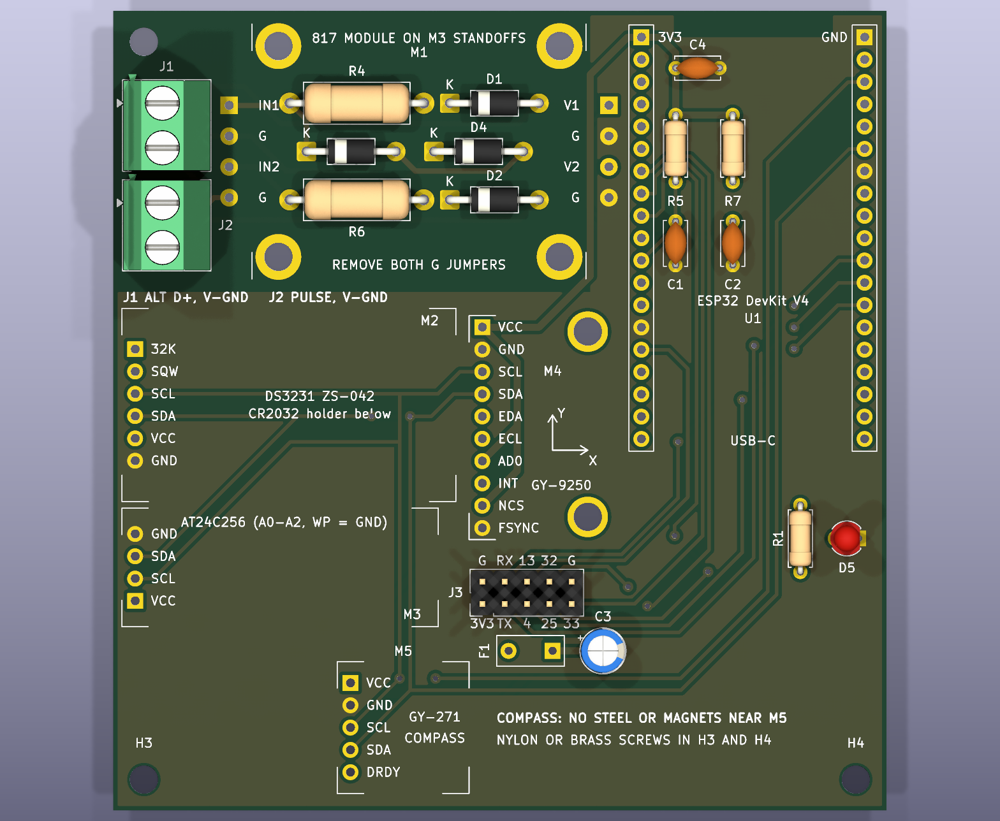

# Hour Meter devboard: ESP32 V4 module carrier with compass (rev D)

An 88 × 91 mm, 2-layer, through-hole carrier for ready-made modules from Indonesian electronics shops:
- the ESP32 DevKit V4 (USB-C, 38 pins);
- the 2-channel PC817 "817 Module";
- the GY-9250 (MPU9250/6500);
- the DS3231 ZS-042 RTC;
- the AT24C256 EEPROM;
- the GY-271 compass (QMC5883L or HMC5883L).

The DevKit's USB-C is the only supply. Vehicle wires go to screw terminals, and every other part is a common THT part.

The devboard is rev D of the module carrier: rev C plus a socket for a GY-271 compass, on a board 20 mm taller ([Changes from rev C](#changes-from-rev-c)). GY-9250 modules sold locally often carry an MPU6500, which has no compass; the GY-271 always has one. The firmware pins are those of the earlier carriers, so it runs the `esp32dev` build.



| | |
|---|---|
| Schematic | `hour-meter-devboard.kicad_sch` (PDF: `hour-meter-devboard.pdf`, picture: `hour-meter-devboard.png`) |
| PCB | `hour-meter-devboard.kicad_pcb` (pictures: `hour-meter-devboard-pcb.png`, `hour-meter-devboard-3d.png`) |
| Ready to order | `production/hour-meter-devboard-gerbers.zip` (Gerbers + drill files) |
| Parts list | `production/hour-meter-devboard-bom.csv`: what to buy, with the search terms local shops use |
| LCSC order | `production/hour-meter-devboard-lcsc-upload.csv` for LCSC's BOM tool, and `-lcsc-parts.csv` with part numbers, stock and fit notes ([Buying the parts](#buying-the-parts)) |
| Check before ordering | `production/hour-meter-devboard-fit-check-1to1.pdf`: print at 100 % and lay the modules on it |
| Custom parts | `hour-meter-modules.kicad_sym` (symbols), `hour-meter-modules.pretty/` (footprints, from `tools-gen-footprints.py`) |
| Input simulations | [fault analysis](../fault-analysis/README.md), *V4 module carrier* group |
| Firmware | `pio run -e esp32dev -t upload` in `esp32/` (the default build); module wiring and tests in [WIRING.md](../../esp32/docs/WIRING.md) |

**Checks at release (rev D, 2026-11-04, after the [hand edits and their audit](#hand-edits-and-audit)):**
- ERC: 0 errors, 0 warnings.
- DRC: 0 errors, 0 warnings, 0 unconnected, 0 schematic mismatches. JLCPCB's 2-layer limits pass too.
- 2 copper layers; the Gerbers hold copper L1/L2 only.
- Logic copper stays at least 3.8 mm from vehicle copper (the netclass minimum is 0.8 mm).

## What is on the board

| Ref | Part | Connects to |
|---|---|---|
| U1 | ESP32 DevKit V4 on 2 × 19 sockets. The antenna overhangs the top edge; the USB-C end points down | everything |
| M1 | 817 module on 4 M3 standoffs, above its own input protection | J1/J2 inputs → GPIO27/GPIO26 |
| M2, M3, M4 | DS3231, AT24C256 and GY-9250, lying flat on sockets, chip side up | I2C, 3V3 |
| M5 | GY-271 compass, lying flat on a 1×5 socket in the bottom strip, far from the DevKit and the RTC battery | I2C, 3V3; DRDY not connected |
| J1, J2 | Screw terminals: alternator (D+/L) and 12/24 V pulse; pin 2 = vehicle ground | M1 inputs |
| J3 | Spare 2 × 5 header: UART2 and five GPIOs, 3V3 through F1 | U1 |
| D5 | Status LED (green, 3 mm) | GPIO2 |

| ESP32 pin | Use | | I2C address | Device |
|---|---|---|---|---|
| GPIO21 / 22 | I2C SDA / SCL (100 kHz, module pull-ups) | | 0x50 | AT24C256 (A0–A2 = GND) |
| GPIO27 | ALT_IN, from J1 through 817 channel 1 (LOW = running) | | 0x68 | DS3231 |
| GPIO26 | PULSE_IN, from J2 through 817 channel 2 | | 0x57 | AT24C32 on the ZS-042 (unused) |
| GPIO17 / 16 | UART2 TX / RX on J3 | | 0x69 | MPU9250 / 6500 (AD0 = 3V3) |
| GPIO4, 13, 25, 32, 33 | Spare, on J3 | | 0x0C | AK8963 magnetometer (MPU9250 only) |
| GPIO2 | Status LED D5, active high. **The firmware doesn't drive it yet** | | 0x0D | QMC5883L on the GY-271 (most modules sold today) |
| | | | 0x1E | HMC5883L on older GY-271 modules |

J3, seen from the top (labels on the silkscreen, full pinout on the back):

```
upper row   2 GND    4 RX2 (IO16)   6 IO13   8 IO32   10 GND
lower row   1 3V3*   3 TX2 (IO17)   5 IO4    7 IO25    9 IO33        * through F1, 0.1 A PTC
```

J3 is for 3.3 V logic only, and nothing on it is vehicle-proof. GPIO12, 14 and 15 are left off: 12 and 15 are boot strapping pins, and 14 puts out PWM at boot.

## ⚠ Measure before you order

The module footprints use typical clone dimensions. **Print `production/hour-meter-devboard-fit-check-1to1.pdf` at 100 %** (no "fit to page"). Check that the board outline measures 88 × 91 mm, then lay each module on its outline: the pins must land on the pads. If one doesn't fit, change its numbers in `tools-gen-footprints.py` and regenerate (see [the end](#regenerating-after-a-change)).

| Part | Assumed | Check |
|---|---|---|
| ESP32 DevKit V4 | 2 × 19 pins, rows **25.4 mm apart** (Espressif's DevKitC footprint), antenna about 7 mm beyond pin 1 | Some narrow 38-pin clones use 22.86 mm |
| 817 module | 38 × 29 mm, 4 × M3 holes **32 × 24 mm** apart | Only one seller lists the hole spacing |
| GY-9250 | 15.5 × 25.5 mm, 10 pins down the left edge; M3 holes 12 mm right of the pins, 0.5 mm and 21.6 mm below pin 1 | The holes come from a photo. If they don't line up, leave the two standoffs out |
| DS3231 ZS-042 | 38 × 22 mm, 1 × 6 pins on one short edge, 32K at the top | |
| AT24C256 | About 36 × 13.5 mm, 4 pins on one short edge: GND, SDA, SCL, VCC from the top | Other boards differ: match the labels |
| GY-271 | Up to 15 × 15 mm, 5 pins: VCC, GND, SCL, SDA, DRDY from the top | Sellers list 13–15 mm; check the pin order on yours |
| F1 | 5.0 mm lead pitch | |

## Ordering the PCB

Upload `production/hour-meter-devboard-gerbers.zip` to a local PCB maker or to JLCPCB / PCBWay (both ship to Indonesia).

| Setting | Value |
|---|---|
| Layers, size | 2 layers, 88 × 91 mm, FR-4 1.6 mm, 1 oz copper |
| Finish, colour | HASL (lead-free is fine), any colour, silkscreen on both sides |
| Smallest track / gap | 0.4 mm / 0.3 mm (0.8 mm between vehicle and logic copper) |
| Smallest hole | 0.6 mm (vias, 1.2 mm pads); component holes 0.8–1.3 mm, mounting holes 3.2 mm |
| Silkscreen text | 1.0 mm and up |

These rules are coarser than most fabs need, so a local maker who can't do fine tracks can still make this board. No assembly service is needed.

## Buying the parts

Everything is in `production/hour-meter-devboard-bom.csv`, with a search term for Tokopedia, Shopee or a shop counter. Besides the five modules and the THT parts, it lists:
- the female headers: 2 × 1×20 (cut to 19), 1×6, 1×4, 1×10, 1×5;
- a 1×40 straight pin strip for re-fitting the module headers;
- 4 nylon M3 spacers (10–12 mm) for the 817 module;
- 3 nylon (or brass) M3 screws for the mounting holes: steel near the compass shifts its reading;
- hook-up wire and a CR2032.

**From LCSC, together with the JLCPCB order:** upload `production/hour-meter-devboard-lcsc-upload.csv` in LCSC's BOM tool.
- **What it covers:** every THT part, the sockets and headers, and the 817 module's nylon standoffs and screws.
- **Size:** 20 lines in quantities for 5 boards (JLCPCB makes 5 PCBs), about US$15 before shipping. Stock and prices were seen on 2026-11-04.
- **Fewer boards:** lower the quantities in the cart. Most lines are already at LCSC's minimum.
- **Details:** `-lcsc-parts.csv` gives every part's stock, its fit against the footprint, and the optional lines (P6KE18A, GY-9250 standoffs).
- **Not on LCSC:** the six modules, the CR2032 and hook-up wire. Buy those locally.

Fit notes for the LCSC parts:
- **R1, R5, R7:** 1/6 W parts with a 3.4 mm body, so the leads bend easily on the 7.62 mm footprint. They carry 2 mW at most.
- **D5:** a yellow-green GaP LED (about 2 V). From 3.3 V through 1 kΩ it gets about 1.4 mA. A 3 V "emerald" green would barely light.
- **J1, J2:** the KF128-5.08 is a true 5.08 mm part. Its pins are a snug fit in the 1.3 mm holes.

**D3/D4:** the 1N4744A (15 V, 1 W zener) suits 12 V vehicles, and 24 V vehicles whose alternator clamps load dump (all recent ones). On an older 24 V truck without that clamp, fit a **P6KE18A** TVS in the same holes instead ([simulation](../fault-analysis/README.md#results)).

## Preparing the modules

Every module lies flat, chip side up, on a standard 8.5 mm female socket. Each needs a straight pin header soldered on its underside, pointing down.

1. **817 module:** remove **both G jumpers**. With a jumper fitted, the vehicle ground and the ESP32 ground are joined and the isolation is gone ([WIRING.md](../../esp32/docs/WIRING.md#the-817-module)).
2. **DS3231 ZS-042:**
   - Remove the **charge resistor** (or its diode) beside the battery holder; a CR2032 is not rechargeable ([WIRING.md](../../esp32/docs/WIRING.md)).
   - Replace the right-angle header with a straight one on the battery side. The holder then faces the carrier; no parts sit under it.
3. **AT24C256:** set the A0, A1, A2 and WP jumpers to GND (address 0x50, writes allowed). Move its header to the underside.
4. **GY-9250:** solder its header on the underside.
5. **GY-271:** solder its 1×5 header on the underside, so the chip faces up. Most modules sold today carry a QMC5883L (marked 5883 or DA 5883); it answers at I2C address 0x0D.
6. **DevKit:** as sold.

## Assembly order

1. **Low parts first, including the ones that end up under modules:**
   - R5, R7, C1, C2 and C4 go under the DevKit; R1 goes below its USB end, under the cable plug.
   - D1–D4, R4 and R6 go under the 817 module.
   - D1/D2 (1N4007) and D3/D4 (1N4744A) look alike: check the print. The band goes to the **K** mark.
2. **The other parts:**
   - F1, then C3 (long leg to the square + pad) and D5 (long leg to the round pad);
   - J1 and J2, with the wire entry facing the board edge;
   - J3.
3. **Sockets:**
   - 2 × 1×19 for the DevKit: plug the DevKit in while you solder them, so the rows stay parallel.
   - 1×6 (M2), 1×4 (M3), 1×10 (M4) and 1×5 (M5).
4. **817 module:**
   - Solder 8 short wires (about 4 cm) into the **IN1 G IN2 G** and **V1 G V2 G** pads.
   - Mount the module on its 4 spacers.
   - Screw the wires into its terminals in the same order: inputs on the left, outputs on the right.
5. **Plug in the modules.** The pin names printed on each module must match the labels beside its socket.
6. **First power-up:**
   - Connect USB-C to a PC and open the [configurator](../../configurator/README.md) (`hour-meter /dev/ttyUSB0`).
   - Its Overview screen lists the modules and the device clock. `hour-meter read /dev/ttyUSB0 --imu` shows the IMU live.
   - Then check the inputs as in [WIRING.md](../../esp32/docs/WIRING.md#checking-it-with-a-multimeter-esp32-powered).

## In the vehicle

- **Power:** use a USB car charger with 5 V, 1 A or more, rated for 24 V if the truck is 24 V.
  - Its ground is usually the vehicle ground. The 817 module then still keeps vehicle spikes off the GPIOs, but the two grounds are no longer isolated.
- **Inputs:** J1 takes the engine-running wire (alternator D+/L or the oil-pressure switch) on pin 1 and vehicle ground on pin 2. J2 takes a 12/24 V pulse. To find the right wire, see [Pick the wire](../../esp32/docs/WIRING.md#pick-the-wire).
- **Mounting:** M3 screws in H1, H3 and H4, solidly fixed: the vibration check needs it.
  - H3 and H4 are the bottom corners, beside the compass: use nylon or brass screws there.
  - The DevKit's corner (top right) has no hole. If the box allows, rest it on a rubber pad or a standoff, so it can't shake.
  - Mount the box away from steel brackets, speakers and heavy current cables if you want a usable heading.
  - The X and Y arrows on the silkscreen show the IMU axes; level the IMU with the configurator's calibration.

## Design notes

- **Power:**
  - The DevKit's 5V pin is unused, so nothing can back-feed the USB port.
  - All modules run from the DevKit's 3V3 regulator. This keeps their I2C pull-ups at 3.3 V; the ESP32's pins are not 5 V tolerant.
  - F1 (0.1 A PTC) feeds J3's 3V3, so a short outside the box can't pull the DevKit's 3V3 down.
- **Vehicle inputs:** each input runs through D1 (reverse polarity), R4 (1.5 kΩ, 1 W, current limit) and D3 (15 V clamp) into the 817 module.
  - **Turn-on and current:** the GPIO goes LOW from about 3 V on the terminal, so a key-on charge-lamp wire (below 2 V) reads as stopped. The PC817 LED gets 1.9 mA at 12 V and 4.0 mA at 28.8 V.
  - **Within ratings:** the module's input stays below 16 V, and every part within its rating, for every 12 V case, the clamped 24 V load dump and ISO 7637-2 pulses 1 and 2a.
  - **Exception:** the unclamped 24 V load dump, which is what the P6KE18A option is for.
- **Isolation:**
  - The vehicle zone (top left, under the 817 module) has no ground pour on either layer.
  - Its nets use the `Vehicle` netclass, with 0.8 mm clearance.
  - Logic copper stays at least 3.8 mm away: the GND pour is 3.8 mm from J2's ground pin, and the closest logic track is ALT_IN, 4.1 mm from D2.
- **Compass (M5):** the bottom strip keeps it about 40 mm from the DevKit (USB current, Wi-Fi bursts) and 38 mm from the RTC's CR2032 (a steel can).
  - **Supply tracks:** those near it carry a few mA and add about 0.07 µT at the chip. Earth's field here is about 38 µT.
  - **J3:** its 3V3 also runs past M5. A 100 mA load on J3 adds about 1 µT, about 1.4° if that current changes.
  - It runs from 3V3 like the other modules, so its I2C pull-ups stay at 3.3 V. With every module's own pull-ups in parallel the bus pull-up is about 1.6 kΩ, within I2C's 3 mA sink limit.
  - DRDY is left open: the firmware can poll the chip.
- **Antenna:** it overhangs the top edge, and the 3 mm of board under its end is a copper keep-out.
- **Heights:**
  - About 8 mm fits under the DevKit (its board sits 11 mm up) and about 6 mm under the 817 module (on 10–12 mm spacers).
  - C3 (11 mm tall), F1, J3 and D5 stay outside every module.
  - The strip below the DevKit's USB-C end holds only low parts, because the cable plug sits above it.
- **Status LED:** D5 with R1 to ground holds GPIO2 low at boot, which is what download mode needs.

## Changes from rev C

| | Rev C | Rev D (this board) |
|---|---|---|
| Compass | only the GY-9250's AK8963, which MPU6500 modules lack | GY-271 on its own 1×5 socket (M5) |
| Size | 88 × 71 mm | 88 × 91 mm: a 20 mm strip along the bottom for the compass |
| Mounting holes | H3 under the AT24C256, H4 at the right edge | 3 holes: H1 top left, H3 and H4 in the bottom corners (nylon or brass screws). H2 under the DevKit was removed |
| Silkscreen | | compass warning beside M5; rev D on the back |
| Everything else | | unchanged: same modules, input protection, vehicle zone and pins. Re-routed (Freerouting, then by hand), so the tracks differ |

The input circuit is unchanged since rev C, so its [input simulations](../fault-analysis/README.md) apply as they are.

**Earlier carriers:** rev C (`hour-meter-esp32-v4`) and rev A (`hour-meter-esp32`) were removed from the repository on 2026-11-04, when this board was renamed from `hour-meter-esp32-v4-compass` to `hour-meter-devboard`. They are in the git history at commit d35ef2d, for example `git show d35ef2d:schematic/hour-meter-esp32-v4/README.md`.

## Firmware to do

- **Compass driver:** firmware 2.7.0 reads only the MPU9250's own magnetometer (AK8963). The GY-271 needs a QMC5883L driver (address 0x0D), and ideally HMC5883L (0x1E) too, feeding the existing heading filter and the magnetometer calibration.
- **Axes:** the GY-271's printed X/Y arrows depend on the seller. Map them to the board's X/Y arrows (beside M4) in the driver, or in the calibration.

## Hand edits and audit

After the scripts made the board, it was edited by hand in KiCad on 2026-11-04:
- **Moved:**
  - C1, C2, R5 and R7 (still under the DevKit);
  - C3 and F1, to beside J3;
  - D5 and R1, to below the DevKit's USB end.
- **Removed:** H2.
- **Re-routed:**
  - +3V3, now 0.8 mm wide;
  - I2C, the J3 lines, UART, the opto outputs and the LED.
- **GND:** the tracks are gone; the pours carry GND.

The audit then fixed three things:

| Found | Fix |
|---|---|
| Two dimension lines on F.Cu: they would have been etched in copper, touching the board edge | Moved to User.Drawings and measured edge to edge: 88 × 91 mm |
| The GND pour's corner had moved 2 mm into the vehicle zone. It came 1.5 mm from J2's vehicle-ground pin (was 3.8 mm) and 2.7 mm from D1/D2's input pads (was 4.7 mm) | Corner put back: 3.8 mm and 4.7 mm again |
| R1's reference printed over D5's pad | Moved beside R1 |

After the audit, the +3V3 track beside the vehicle zone was re-drawn 0.4 mm closer to the zone. It is now 4.3 mm from D1/D2's input pads (was 4.7 mm). DRC is still clean, and the closest logic copper is still the GND pour, 3.8 mm from J2's vehicle-ground pin. The production files were rebuilt from this final board.

Smoke test, simulated on the final copper:

| Test | Result |
|---|---|
| Vehicle inputs, 11 ngspice cases ([fault analysis](../fault-analysis/README.md)) | Unchanged: 10 pass. The unclamped 24 V load dump needs the P6KE18A option |
| 3V3 to the modules (14 mA) | Within 0.8 mV of the DevKit's 3V3; within 8.2 mV with 100 mA drawn from J3 |
| Field at the GY-271 from the supply currents | 0.07 µT (about 0.1°); 0.95 µT with 100 mA drawn from J3 |
| I2C | SCL 229 mm and SDA 209 mm of track. Estimated rise time about 120 ns; 1000 ns is allowed at 100 kHz |
| Part heights | Under the DevKit, at most about 7 mm (8 mm free). C3 and F1 sit outside every module. Only R1 (2.5 mm) is under the USB plug |

## Regenerating after a change

**The board is now hand-routed.** Running `tools-build-pcb.py place` or `tools-route-pcb.py` again would replace the hand edits with a fresh placement and Freerouting result. After a change in KiCad, run only `tools-production.py`.

The board was first produced by scripts:

```bash
python3 tools-gen-footprints.py      # 1. module footprints (edit dimensions after measuring)
python3 tools-build-pcb.py place     # 2. netlist -> footprints -> placement (PLACEMENT table); `check` = dry run
python3 tools-route-pcb.py           # 3. keep-outs and fence -> Freerouting -> GND pours
python3 tools-production.py          # 4. 2-layer and DRC checks -> Gerbers zip, BOM, fit-check PDF, pictures
```

- **Schematic edits:** use KiCad (or the Konnect tools), then run steps 2–4.
- **References:** `tools-build-pcb.py` puts each reference beside its part, where it touches no pad or other silkscreen.
- **Routing:** Freerouting is not deterministic, so a re-run gives slightly different traces. It runs with pin neck-down off, so every track keeps its netclass width.
- **By hand:** you can also open `hour-meter-devboard.kicad_pro` in KiCad, move parts and route interactively. Run `tools-production.py` afterwards for the checks and files.
