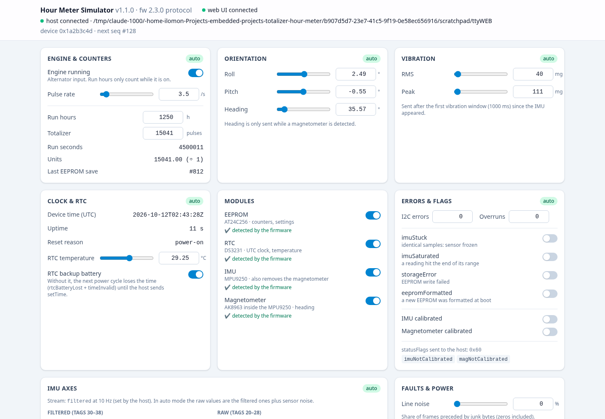
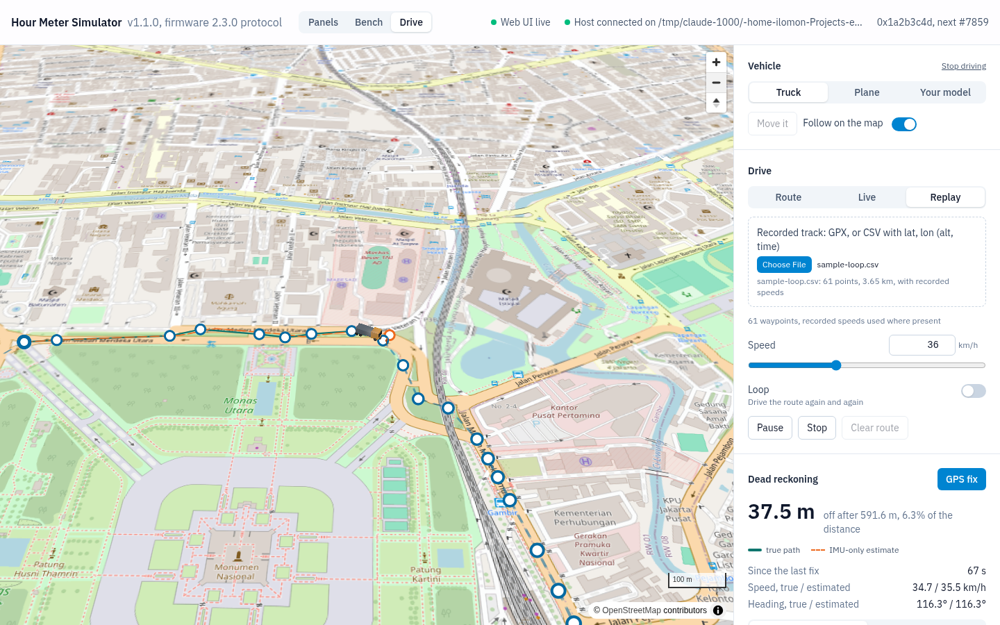

# Hour meter simulator

**A fake hour-meter device on a virtual serial port.** It speaks the real protocol (SensorFrame v1, firmware 2.5.0): it sends TELEMETRY, IMU stream and EVENT frames and answers your COMMANDs with the same ACKs, error codes and quirks as the firmware. Use it to write and test a driver without the hardware.

```bash
cd simulator
deno task start                 # creates /tmp/ttyHourMeter (needs socat)
deno task start --web           # same, plus a web UI at http://127.0.0.1:8080/: every value, a 3D bench, a vehicle on a map
```

Then open `/tmp/ttyHourMeter` in your driver like any serial port (any baud rate, 8N1). Try it with the project's own tools:

```bash
cd configurator                                            # or the hour-meter release binary
deno task start read /tmp/ttyHourMeter                     # live telemetry
deno task start get hour --port /tmp/ttyHourMeter          # one command, one ACK
deno task start /tmp/ttyHourMeter                          # full configurator (TUI)
```

Needs [Deno](https://deno.com) 2 and, for the virtual tty, `socat` (`apt install socat` / `pacman -S socat` / `brew install socat`). Without socat, use `--tcp`.

### Without Deno: download a binary

Standalone binaries for Linux (x64, arm64), macOS (Intel, Apple Silicon) and Windows (x64) are on the [releases page](https://github.com/ilomon10/embedded-totalizer-hour-meter/releases) (tags `simulator-v*`). They take the same options as `deno task start`:

```bash
tar -xzf hour-meter-sim-1.0.0-linux-x64.tar.gz
./hour-meter-sim-1.0.0-linux-x64/hour-meter-sim              # /tmp/ttyHourMeter (needs socat)
./hour-meter-sim-1.0.0-linux-x64/hour-meter-sim --tcp 5555   # no socat needed
```

On Windows there is no socat: use `hour-meter-sim.exe --tcp 5555`, or pair it with a virtual COM-port pair (e.g. com0com) and a TCP-to-serial bridge. On macOS, if Gatekeeper blocks the unsigned binary, run `xattr -d com.apple.quarantine hour-meter-sim` once. Check a download with `sha256sum -c SHA256SUMS`.

## What you get

| | Same as the real device |
|---|---|
| **Frames** | Byte-identical to the firmware. The tests rebuild the firmware's golden frames from `esp32/test/test_app` and every dump in [FRAME-CATALOG.md](../esp32/docs/FRAME-CATALOG.md) |
| **Timing** | TELEMETRY every `telemetryIntervalMs`, IMU stream at `imuStreamHz`, module checks every 2 s, calibration 5 s (IMU) / 20 s (magnetometer) |
| **Commands** | All-or-nothing validation, `rejectedTag`, setting ranges and the `imuStreamHz ≤ imuSampleHz` rule, `resetCounters` magic, `get=1…4`, a retried `seq` within 10 s replays the ACK, reboot 100 ms after the ACK (boot EVENT `lastCause` 5, `lastStage` 8) |
| **Panic signal** | 64 `0x00` bytes in a row on a wired link (tty, TCP, stdio) restart the device at once, with no ACK: next boot EVENT has `resetReason` 3, `lastCause` 4, `lastStage` 8, counters saved first. A `--bt` session ignores it. The web *Panic signal* button does the same |
| **Restart cause** | The full status block (boot EVENT, `get=3`) carries `lastCause` (tag 62: 0 none, 1 watchdog, 2 i2cStuck, 3 usbStalled, 4 panicSignal, 5 rebootCommand, 6 crash) and `lastStage` (tag 63), 0/0 at power-on. Flag bit 18 is `safeMode` |
| **Port open** | Opening the tty reboots the device (boot EVENT, `seq` back to 0), like an ESP32 DevKit whose DTR line resets it. `--no-reset` turns this off |
| **State** | The engine runs 40 s on / 40 s off, the hour meter and totalizer count up, and counters are saved every `persistIntervalS`. Settings and time persist across reboots, as with EEPROM and the RTC |
| **Values** | Each sensor animates by itself (engine cycle, gentle tilt, engine vibration, noise) until you set it in the [web UI](#web-ui) |
| **Not simulated** | Real sensor physics, the UART pins (the simulated port is the USB port) |

## Web UI

`--web [port]` starts a control page (default http://127.0.0.1:8080/) next to the serial port:



- **Every value the device sends:** engine and pulse rate, run hours and totalizer, roll/pitch/heading, vibration, raw and filtered accel/gyro/mag, RTC temperature and backup battery, I2C errors and overruns, the extra status flags (`imuStuck`, `imuSaturated`, `storageError`, `eepromFormatted`), and IMU/magnetometer calibration.
- **Auto or manual, per group:** a group animates by itself (`auto`) until you touch one of its controls, then holds your values (`manual`). Click *manual · back to auto* to release it. Touching one value keeps the rest of the group where it was.
- **Modules:** plug and unplug the EEPROM, RTC, IMU and magnetometer. "Detected" follows the firmware's timing: lost after 3 missed checks (~6 s), found within 2 s, with EVENT kind 3.
- **Faults and power:** line noise and frame corruption (changed live; `--scenario noise/corrupt` set the starting values), reboot, watchdog reset (`lastCause` 1), panic signal, freeze (a hung MCU), power cycle.
- **Read-only views:** the settings the host wrote, the `statusFlags` word the host receives, and a frame log of everything sent and received (filter by type, pause, clear).

The values reach the wire exactly as the firmware would encode them: set roll to 15° and the host decodes `roll 15°`.

The page has no login. It listens on 127.0.0.1 only, unless you pass `--web-host 0.0.0.0` to open it to your LAN; do that only on a network you trust.

It is a React + Tailwind app in `web/`, built with Vite (`deno task web:build`) and embedded in the release binaries. While working on the page itself, run the simulator with `deno task start --web 8080` and `deno task web:dev` side by side, which serves the page with hot reload and forwards the WebSocket.

### Bench (`/3d`)

A 3D model of the carrier board. Drag to tilt it (left/right = roll, up/down = pitch), drag the compass ring to turn the heading, double-click to level; with the board focused, arrow keys and `[` `]` nudge by 1° (Shift: 10°). Custom vibration has presets and shakes the board (not under reduced motion). The IMU stream's accelerometer and magnetometer follow the attitude, so a driver that computes roll, pitch and heading itself gets the same answer as the device.

## Drive: vehicles, maps, dead reckoning (`/drive`)

The hour meter rides in a vehicle on a real map. The simulator turns the vehicle's motion into the IMU data the device would send: forward and centripetal acceleration, rotation rates, the earth's field, engine and road vibration. It runs those samples through **a port of the firmware's own IMU pipeline** (its Kalman filters, vibration meter and compass), so roll, pitch and heading are what the device would really report, errors in turns included.



- **Vehicles:** a truck (bicycle model, suspension roll and squat, tyre grip limit about 0.45 g), a plane (coordinated turns, climb, stall speed), or **your own model** (`.glb`/`.gltf`, kept in your browser) that moves like either. Turn it 90° at a time until the orange arrow under it points at its nose.
- **Route:** click the map to add waypoints, drag to move them, double-click to delete; set speed (and height for the plane), loop, Play/Pause/Stop. Playback is driven, not drawn: a path follower steers and brakes like a driver.
- **Live:** keyboard (W throttle, S/Space brake, A/D steer, X drive/reverse, Q/E climb, R GPS fix) or a **gamepad**. *Gamepad controls* shows every binding live: press *Assign* and move the stick, trigger or button you want; *Flip* reverses a direction; the mapping is saved in your browser. Default: right trigger throttle, left trigger brake, left stick steers (and climbs), B/circle = drive/reverse, A/cross = GPS fix. The vehicle brakes if the controls stop for 0.5 s. The truck's **reverse gear** (up to 18 km/h) engages only at standstill: until then the *Gear* badge says "stop to engage R" and the throttle brakes.
- **Mounting** (truck): fit the board turned (*Forward*, *Right*, *Backward*, *Left*, or any yaw) and tilted up to ±30°. The IMU data, the firmware's roll/pitch/heading and everything a host receives then come from the turned board, as on a vehicle where the box could only be screwed in sideways.
- **Replay:** drop a GPX file (`<trkpt lat lon>` with optional `<ele>` and `<time>`) or a CSV with a header naming `lat`, `lon` and optionally `alt`/`ele` and `time` (ISO 8601 or Unix seconds). With times, each stretch is driven at its recorded speed. Try [`docs/sample-loop.csv`](docs/sample-loop.csv), a lap of Jl. Medan Merdeka around Monas in Jakarta built from OpenStreetMap road geometry.
- **Map:** OpenStreetMap tiles (© OpenStreetMap contributors). They need internet; offline, a grid with lines about 220 m apart is shown and everything else works. The tiles are OSM's free service: fine for testing, not for heavy automated use ([tile usage policy](https://operations.osmfoundation.org/policies/tiles/)).

### Dead reckoning: what the numbers mean

Firmware 2.5.0 sends no position or speed, so moving without GPS is the host's job, integrating the IMU stream. The page draws the **true path** (solid) and a **reference estimate** (dashed orange) built only from the IMU frames the host receives (same rate, same 1 mg / 0.1 °/s resolution), plus the error in metres. *GPS fix* re-anchors the estimate to the truth, like a real fix.

- **Ground vehicles:** gravity is learned while parked, and a zero-velocity update zeroes the speed whenever the truck stands still (judged by vibration, not by the mean: a truck cruising at constant speed reads pure gravity too, but shakes far more than an idling one). Heading integrates the gyro about "up".
- **Aircraft:** a 3D strapdown INS. In a coordinated turn the accelerometer feels no sideways force, so gravity can't be read off it (the firmware's roll even reads level while banking 45°); attitude must come from the gyro.
- **Stream rate matters most.** The default `imuStreamHz` is 10. Set `hour-meter set imuStreamHz=100 streamMode=2` for dead reckoning: in the tests, a plane's estimate after 2.8 km is 31 m off at 100 Hz but 412 m off at 10 Hz.
- **Expected errors a driver must live with:** suspension squat under acceleration tilts gravity onto the forward axis (an IMU can't tell it from acceleration: about 10% speed over-estimate after pulling away); the firmware's roll/pitch filter trusts the accelerometer strongly, so reported pitch absorbs braking and acceleration (don't remove gravity with it on the ground).
- **Reverse:** the estimate's speed is signed. It goes negative while backing up because the acceleration points to the tail, and the zero-velocity update re-zeroes it at every stop.
- **Sign convention:** positive pitch is nose up (firmware 2.4.0 fixed the sign; 2.3.0 reported nose down).

### Mounting calibration: finding "level" and "front" from the IMU

A host can't assume the board's x axis is the vehicle's nose. *Mounting → Calibrate from the IMU* finds the fitting from the stream alone, in two steps:

1. **Level:** stop the truck and press *Level*. For 2 s the accelerometer reads only gravity, so its mean is "up" in board axes, which gives the tilt. The same comes from the reported roll/pitch at rest.
2. **Front:** press *Front* and pull away straight ahead. The accelerometer minus gravity, flattened onto the ground, points to the nose, which gives the yaw. This needs the drive: gravity reads the same for any yaw, and the compass measures the board's x axis, not the nose.

The panel shows what it found next to what is fitted, for example a yaw of 89.6° found against 90° fitted. From then on the reference estimate takes forward as (accel − up) · front (so reversing is negative) and the vehicle heading as the compass heading minus the yaw. Without a calibration, a board fitted sideways reads every acceleration as sideways, and the estimate gets lost. The firmware has no mount setting (its settings slot is full), so this is the host's job, and the simulator shows how to do it (`src/vehicle/mount-cal.ts`).

From the command line, the same without a browser (CI):

```bash
deno task start --drive truck --route docs/sample-loop.csv --loop   # starts at the track's first point
deno task start --drive plane --origin -6.1754,106.8272 --web       # then draw a route in the browser
```

## Options

```text
deno task start [options]

Port (pick one)
  --pty <path>         virtual tty made by socat (default /tmp/ttyHourMeter)
  --tcp <port>         serve on 127.0.0.1:<port> instead (no socat needed)
  --stdio              frames on stdout, commands on stdin

Device
  --bt                 act as a Bluetooth SPP session: locked until COMMAND unlock=<PIN>
  --pin <0-9999>       btPin setting (default 1234)
  --engine <on|off>    hold the alternator on or off (default: 40 s on / 40 s off cycle)
  --run-hours <h>      hour meter at power-on (default 1250)
  --total <pulses>     totalizer at power-on (default 15000)
  --pulse-hz <n>       totalizer pulses per second while the engine runs (default 3.5)
  --device-id <n>      deviceId in every header (default 0x1a2b3c4d)
  --no-reset           do not reboot when a client opens the tty
  --drive <truck|plane>  a vehicle carries the device (engine, motion, vibration, IMU come from it)
  --origin <lat,lon>     where it starts (default: the route's first point)
  --route <file>         GPX or CSV track, driven at once (headless testing, CI); --loop repeats it
  --web [port]         web UI on http://127.0.0.1:<port>/ (default 8080)
  --web-host <addr>    web UI listen address (default 127.0.0.1; 0.0.0.0 = whole LAN, no login!)
  --seed <n>           random seed for sensor noise and faults (default 1)

Output
  -v, --verbose        log every frame with all its records (stderr)
  -q, --quiet          log nothing but errors
  --version            simulator version and the firmware protocol it speaks
```

The log on stderr shows each session, every COMMAND and its ACK, and every EVENT (`-v` adds TELEMETRY and IMU):

```text
09:44:02.237 client connected on /tmp/ttyHourMeter
09:44:02.237 -> EVENT #0 boot devices=0xf flags=imuNotCalibrated,magNotCalibrated
09:44:05.930 <- COMMAND #23383 get=1
09:44:05.932 -> ACK #1 ackSeq=23383 Ok +7 records
```

## Fault scenarios

Test the paths your driver will meet in the field. Combine as many as you like; `--seed` makes random faults repeatable.

```bash
deno task start --scenario no-rtc-battery --scenario corrupt=5
```

| Scenario | What happens | What your driver should do |
|---|---|---|
| `engine-cycle[=onS,offS]` | Alternator on/off cycle (the default, 40,40) | Show `alternator`; run hours only grow while on. `altInput` (tag 10) is the raw input; `alternator` (tag 3) is what counts (input on and, if `runVibMinMg` > 0, vibration confirmed) |
| `acc-wire` | Models the wrong wiring: the engine input is ON whenever the key is on (always), but the engine really runs only from 20 s to 80 s of every 120 s; vibration RMS 8-12 mg when stopped, 40-80 mg when running. TELEMETRY shows `altInput` true while `alternator` is false during the off phase | Without `runVibMinMg` the run hours grow the whole time (the bug). With `hour-meter set runVibMinMg=30` they grow only while the engine runs; `alternator` = counting, `altInput` = raw input |
| `no-rtc-battery` | Time lost at power-on: `timeValid` false, `rtcBatteryLost` + `timeInvalid`, header timestamp = uptime | Send `setTime` (UTC) |
| `no-rtc` | No RTC: `rtcMissing`; after `setTime`, `timeNotBackedUp` | Send `setTime` after every boot |
| `no-eeprom` | No EEPROM: presets answer `DeviceMissing`, settings set `settingsNotSaved` | Warn that counters are not persistent |
| `no-imu`, `no-mag` | Module absent: its records disappear from TELEMETRY | Treat missing tags as "no data", not as zero |
| `module-flap[=module,periodS]` | Unplug/replug `imu` (default), `eeprom` or `rtc` every period (default 30 s) → EVENT kind 3. Lost after 3 missed checks (~6 s), so shorter periods are ignored, as on the device | Update the module list on EVENT kind 3 |
| `reboot[=periodS]` | Watchdog reset every period (default 120 s): boot EVENT, `resetReason` 6, `lastCause` 1, `lastStage` 7, `seq` restarts at 0 | Log unexpected reboots; don't treat a `seq` jump as lost frames |
| `hang[=afterS]` | Frozen MCU after afterS (default 30 s): sends nothing, ignores commands. Only the panic signal (64 zero bytes) or a restart/power cycle from the web UI ends it; the panic signal is honoured because a real watchdog would reboot the device anyway | Time out, then send the panic signal and wait for the boot EVENT (`lastCause` 4) |
| `safe-mode` | Boots as after 3 unplanned restarts: `devices` 0, `eepromMissing`/`rtcMissing`/`imuMissing`/`magMissing` + `settingsDefaults`/`journalEmpty` + `safeMode` (flag 18), counting in RAM, no IMU stream; `lastCause` 1, `lastStage` 7. A power cycle, `reboot` or the panic signal leaves it | Show a "safe mode" banner; don't treat missing modules as hardware faults |
| `noise[=p]` | Random junk bytes (zeros included) before a fraction `p` of frames (default 0.2) | Drop bad frames, resync on the next `0x00` |
| `corrupt[=N]` | One byte flipped in 1 of N frames (default 10) → CRC / COBS errors | Count and drop; never crash |

## Bluetooth mode

`--bt` makes the port behave like a Bluetooth SPP session: every command answers `Locked` (9) and no live data flows until `unlock` (tag 107) carries the PIN. A wrong PIN gives `BadPin` (10), and 5 wrong PINs lock out unlocking for 60 s. Each new connection starts locked again, and connecting does not reboot the device.

```bash
deno task start --bt --pin 4821
hour-meter get status --port /tmp/ttyHourMeter --pin 4821
```

## TCP and stdio

No socat (Windows, Docker), or a driver that already talks TCP to a serial gateway:

```bash
deno task start --tcp 5555        # one client at a time; each connection is a new session
deno task start --stdio | xxd     # raw frames on stdout, logs on stderr
```

## Notes for driver tests

- Between sessions the tty link disappears for a few milliseconds while socat restarts. An automated test that closes and reopens the port immediately should retry `open` once.
- Every frame takes the next `seq`, including frames that were not delivered (no client, Bluetooth locked, `output` set to UART). Gaps in `seq` are normal.
- Writing `output=2` (UART) stops periodic data on this port, exactly as on the device. Commands still work: send `output=1` to get it back.

## Development

```bash
deno task test         # 53 tests: firmware golden frames, catalog dumps, command rules, Bluetooth lock,
                       #   inputs (auto/manual), live faults, web server + WebSocket, attitude round trips,
                       #   vehicle physics, the firmware filter port, route following, track parsing,
                       #   dead reckoning (truck) and the strapdown INS (plane)
deno task check        # type-check (simulator + web UI)
deno task web:build    # build the web UI into web/dist (needed once before `start --web` from source)
deno task web:dev      # web UI with hot reload, talking to `deno task start --web 8080`
deno lint && deno fmt --check
deno task gen-catalog  # print the FRAME-CATALOG.md frames after a protocol change
deno task compile      # builds the web UI, then release binaries for all 5 platforms into dist/ (+ SHA256SUMS)
```

To release: bump `SIM_VERSION` in `main.ts`, run `deno task compile`, tag `simulator-v<version>`, and attach `dist/*.tar.gz`, `dist/*.zip` and `dist/SHA256SUMS` to a GitHub release.

```
simulator/
├── main.ts               CLI: flags → device + scenarios + transport
├── src/
│   ├── protocol.ts       the only bridge to ../sensorframe/js (codec) and ../configurator/src/tags.ts (tag table)
│   ├── frames.ts         frame builders, a port of esp32/lib/App/src/Telemetry.cpp (same record order)
│   ├── commands.ts       command validation, a port of CommandHandler.cpp + SettingsSchema.cpp
│   ├── device.ts         the simulated Application: scheduler, counters, time, modules, calibration
│   ├── inputs.ts         sensor values per group: animation (auto), held (manual) or a vehicle (vehicle)
│   ├── attitude.ts       roll/pitch/heading <-> accelerometer and magnetometer (firmware math, both ways)
│   ├── faults.ts         line noise and frame corruption, adjustable while running
│   ├── access-gate.ts    Bluetooth PIN lock, a port of AccessGate.h
│   ├── scenarios.ts      --scenario: modules, RTC battery, engine cycle, reboots, starting faults
│   ├── splitter.ts       bytes → frames (split on 0x00, COBS, CRC)
│   ├── clock.ts          injected clock + seeded RNG
│   ├── log.ts            human log on stderr
│   ├── transport/        pty (socat), tcp, stdio
│   ├── vehicle/          Drive: geo (lat/lon <-> metres), body frame, truck/plane models, route follower,
│   │                     track parsing, IMU synthesis, the firmware IMU pipeline port, sim (ties them
│   │                     together), dead-reckoning (ground) and strapdown (air) reference estimators
│   └── web/              web UI server (static files + WebSocket) and its message types
├── web/                  the web UI: React + Tailwind (Vite); src/panels/ (Panels), src/playground/ (Bench),
│                         src/drive/ (Drive: MapLibre map, three.js vehicle layer, gamepad mapping)
├── tools/                catalog.ts + gen-catalog.ts (FRAME-CATALOG.md frames), compile.ts (release binaries)
└── test/
```

The protocol tables are not copied: `src/protocol.ts` loads the same codec and tag table the `hour-meter` configurator uses, and `./esp32/scripts/check-docs.ts` keeps those in sync with the firmware's `Protocol.h`. When the firmware changes a frame, port the change to `src/frames.ts` / `src/device.ts`, then run `deno task test`. The golden-frame tests fail until the simulator matches again.
